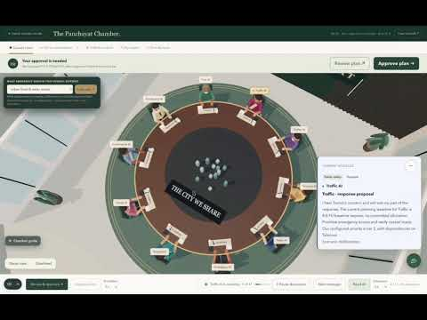
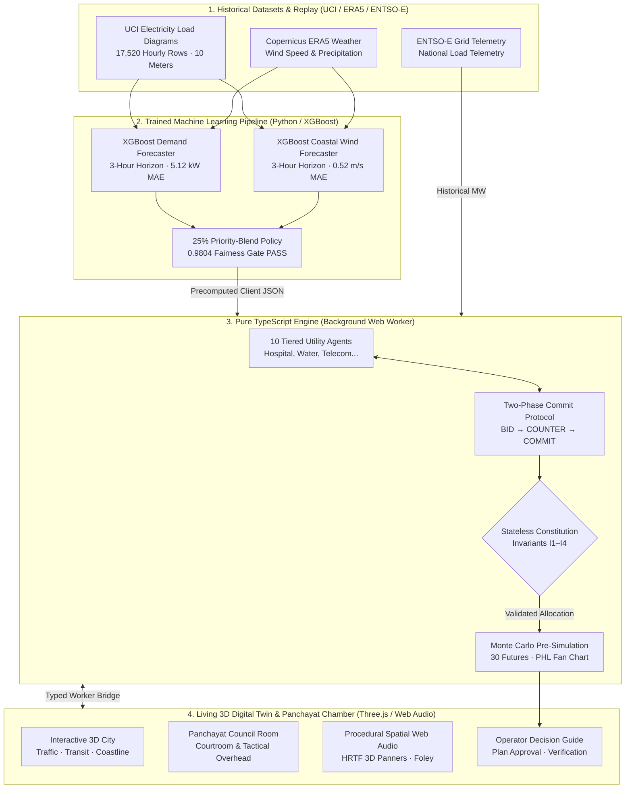
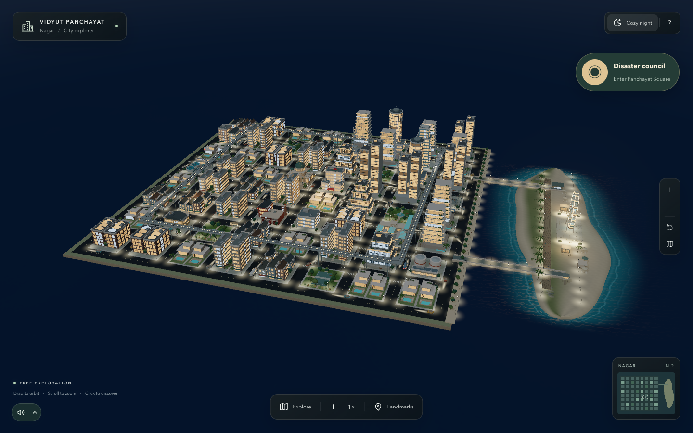
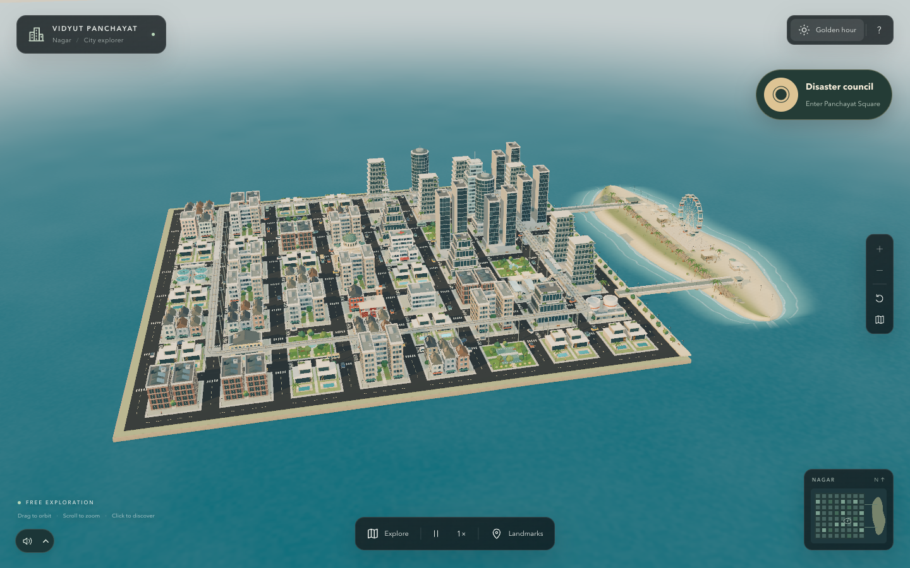
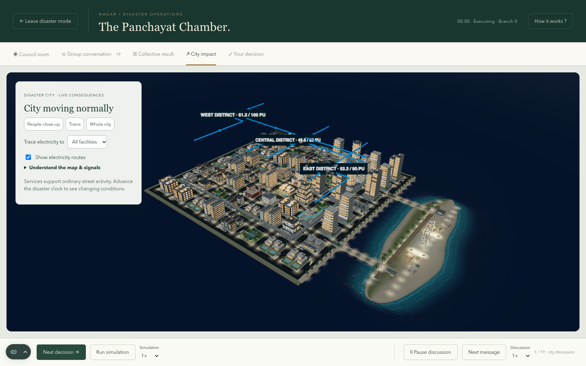
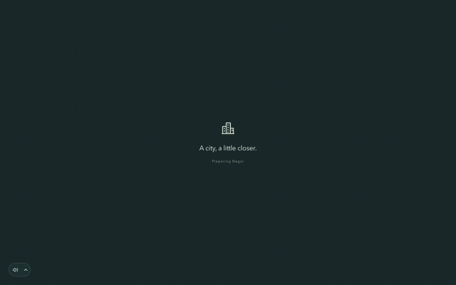
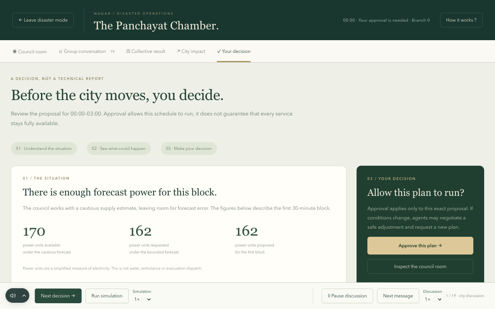
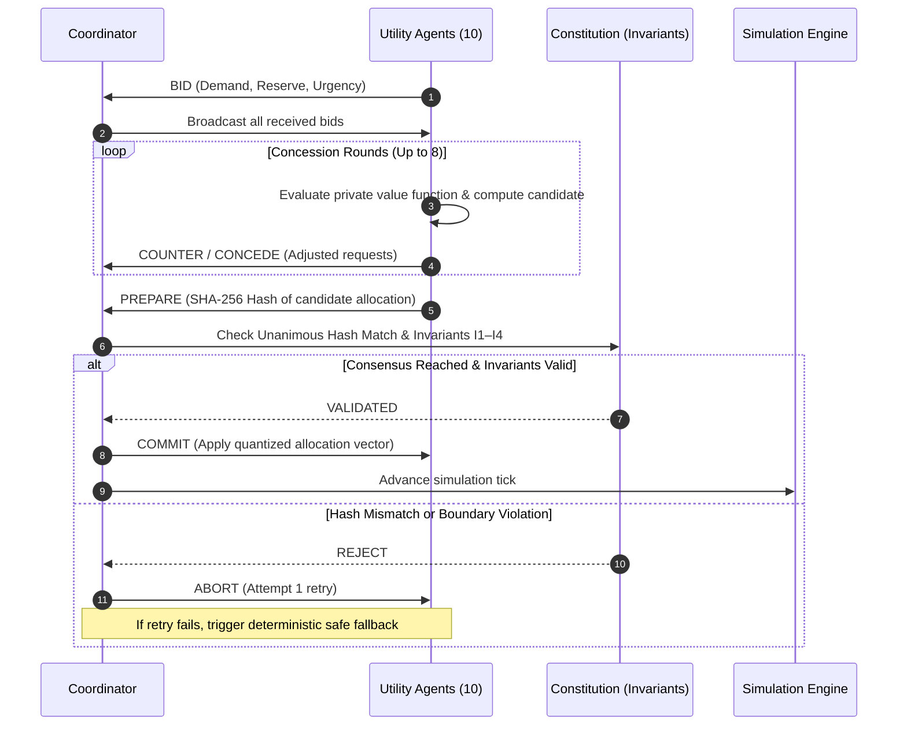

# Vidyut Panchayat (विद्युत पंचायत)
### Autonomous Multi-Agent Crisis Negotiation & Grid Allocation Digital Twin

[](https://www.typescriptlang.org/)
[](https://threejs.org/)
[](https://vitejs.dev/)
[](https://developer.mozilla.org/en-US/docs/Web/API/Web_Audio_API)
[](https://www.python.org/)
[](https://xgboost.readthedocs.io/)
[](https://vitest.dev/)
[](http://127.0.0.1:4174/)
[](https://vidyut-panchayat.onrender.com)

> **Live Deployment on Render**: **[https://vidyut-panchayat.onrender.com](https://vidyut-panchayat.onrender.com)**  
> **Official Final Hackathon Report (PDF)**: **[Hackathon Final Report Vidyut Panchayat (विद्युत पंचायत).pdf](<Hackathon Final Report Vidyut Panchayat (विद्युत पंचायत).pdf>)**  
> **YouTube Video Demonstration**: **[Watch on YouTube](https://youtu.be/M47bBrZDhqE?si=066olxvsF4FaSSmz)**  
> **Vidyut Panchayat** is a decentralized multi-agent crisis governance system and real-time 3D digital twin. During severe grid collapse caused by a 24-hour coastal cyclone, ten autonomous utility agents (Hospital, Emergency, Water, Telecom, Shelter, Traffic, Fuel, Residential, Commercial, Transit) deliberate and clear power allocations using a two-phase commit protocol under a stateless Constitutional validator. Trained XGBoost models predict held-out demand and weather stress, while a background Web Worker guarantees non-blocking, zero-cloud execution with 100% offline reproducibility.

---

## Project Video Demonstration & Walkthrough

[](https://youtu.be/M47bBrZDhqE?si=066olxvsF4FaSSmz)

> 🎥 **[Click here to watch the full walkthrough on YouTube](https://youtu.be/M47bBrZDhqE?si=066olxvsF4FaSSmz)**  
> *Touring the 3D crisis simulation city, the living coastal storm front, the interior 3D Vidyut Panchayat council chamber, autonomous multi-agent negotiations, and real-time Constitution verification.*

---


### 1. The 3D Panchayat Chamber & Multi-Agent Deliberation


*Live recording: Entering the 3D Panchayat chamber, inspecting delegates around the circular council table, reviewing the operator decision guide, and advancing real-time simulation ticks.*

| 3D Council Chamber (Courtroom View) | Overhead Tactical Table |
|:---:|:---:|
|  |  |
| *Official courtroom view: 10 delegates seated at the round table with physical name cards, microphones, and central miniature skyline.* | *Overhead tactical camera view tracking round-table seating, delegate turns, and committed power state.* |

| Council Collective Result Dashboard | Representative Inspection & Case |
|:---:|:---:|
|  |  |
| *Committed decision: 200 PU available, 162 PU allocated, 0 violations, and 100% within-tier fairness.* | *Inspecting representative statements, power demand, allocated capacity, and battery runtime.* |

---
## System Architecture

![Vidyut Panchayat Agent Architecture]



---

## Visual Showcase & Frontend Integration

The user interface combines a real-time Three.js 3D city digital twin with an interactive Panchayat Council deliberation chamber. All animations, vehicle movements, power route lines, and character gestures are driven by engine ticks and Web Worker messages without mock data or external video assets.


### 3. Dynamic Time-of-Day Illumination & Night Mode


*Live recording: Transitioning from Daylight to Golden Hour to Cozy Night with glowing streetlamps, illuminated building facades, vehicle headlights, and coastal reflections.*

| Cozy Night Skyline | Golden Hour Warm Sunset |
|:---:|:---:|
|  |  |
| *Night mode: illuminated building facades, active bridge/boardwalk lamps, train headlights, and ocean glint.* | *Golden hour lighting casting long amber shadows across residential courtyards and civic quarters.* |

| Disaster Operations at Night | Living 3D City Grid (Daylight) |
|:---:|:---:|
|  |  |
| *Disaster response at night: illuminated elevated power routes and status triage rings.* | *Authored 3D city with street grid, traffic, metro rail, and coastline.* |

---

### 4. Living 3D City & Disaster Response


*Live recording: Navigating the 3D city, focusing on critical facilities (Hospital, Substation), and tracing live electrical power routes during severe cyclone disruption.*

| Living 3D City Grid | Disaster City & Power Route Tracing |
|:---:|:---:|
|  |  |
| *Authored 3D city with street grid, traffic, metro rail, and coastline.* | *Disaster operations with elevated power flow lines across East, Central, and West districts.* |

---

### 5. Operator Interface & Negotiation Trace

| Operator Decision Guide | Negotiation Deliberation Chat |
|:---:|:---:|
|  |  |
| *Plain-language forecast, concern warnings, and human approval action bar.* | *Verifiable engine message ledger (BID, COUNTER, COMMIT).* |

| Representative Inspection | Advanced Technical Evidence |
|:---:|:---:|
|  |  |
| *Real-time power demand, allocated power, and backup reserve.* | *Monte Carlo PHL fan chart, pre-sim envelopes, and guardrails.* |

---

## Real-World Datasets

The simulation integrates three real-world datasets with authored disaster crisis scenarios:

| Dataset | Provider / Source | Volume & Format | Role in Vidyut Panchayat |
| :--- | :--- | :--- | :--- |
| **Electricity Load Diagrams 2011–2014** | [UCI Machine Learning Repository](https://archive.ics.uci.edu/dataset/321/electricityloaddiagrams20112014) | 17,520 hourly rows (2013–2014), 10 Portuguese customer meters, 15-min readings aggregated to hourly kW. | Used to train multi-horizon electricity demand forecasting models across 3,456 held-out test windows. |
| **Lisbon Weather ERA5 Reanalysis** | [Copernicus ECMWF / Open-Meteo](https://open-meteo.com/en/docs/historical-weather-api) | 17,520 hourly rows (2013–2014), Lisbon grid cell (38.75°N, 9.25°W), CC BY 4.0. | Evaluates 3-hour ahead coastal wind speed (m/s) and rainfall (mm/h) forecasting models across 3,502 test windows. |
| **National Grid Telemetry** | [ENTSO-E Monthly Hourly Load Archive](https://www.entsoe.eu/data/power-stats/) | 2006–2015 official workbook, hourly Portugal total load in MW (100% reported coverage). | Provides ground-truth national load telemetry for live comparison during historical replay ticks. |
| **Authored Crisis Scenarios** | Domain Engineered | 4 scenarios (`cyclone_24h.json`, `urban_flood_24h.json`, `heatwave_24h.json`, `grid_fault_24h.json`), 144 ticks. | 24-hour disaster shock timeline: grid collapse, feeder failures, surge demands, and communication blackouts. |

---

## Machine Learning Models & Frozen Audits

Vidyut Panchayat contains **4 trained forecasting models**, **2 frozen policy models**, and **3 comparative benchmark models**:

### 1. Multi-Horizon Demand Forecaster (`artifacts/xgboost/electricity_10_meter_3h.json`)
- **Architecture**: Multi-Output XGBoost Regressor ($10\text{ meters} \times 3\text{ horizons} = 30\text{ output targets}$).
- **Features**: Lagged historical consumption ($t-1, t-2, t-3, t-24$), 24-hour rolling mean/std, day-of-week, and hour-of-day cyclics.
- **Performance (Held-Out Test MAE)**:
  - Horizon 1h: **5.12 kW** (vs. 8.94 kW previous-day; **42.7% error reduction**)
  - Horizon 2h: **6.76 kW** (vs. 8.94 kW previous-day; **24.4% error reduction**)
  - Horizon 3h: **7.77 kW** (vs. 8.94 kW previous-day; **13.1% error reduction**)

### 2. Deep Time-Series Baseline (`artifacts/informer/`)
- **Architecture**: PyTorch Informer Transformer with ProbSparse self-attention mechanism.
- **Evaluation**: 10.26 kW (1h), 10.00 kW (2h), 10.99 kW (3h) MAE. Serves as deep-learning comparator to XGBoost.

### 3. Coastal Wind Speed Forecaster (`artifacts/weather/wind_speed_10m_3h.json`)
- **Architecture**: Multi-horizon XGBoost Regressor for coastal wind velocity.
- **Performance (Held-Out Test MAE)**:
  - 1h: 0.329 m/s (vs. 0.327 m/s persistence)
  - 2h: **0.524 m/s** (vs. 0.564 m/s persistence)
  - 3h: **0.680 m/s** (vs. 0.754 m/s persistence)

### 4. Precipitation Model (`artifacts/weather/precipitation_3h.json`)
- Evaluated against persistence across 3,502 test windows (0.120 mm/h vs. 0.075 mm/h). Because rainfall model skill was weak, the system transparently defaults to persistence baselines.

### 5. Multi-Agent Policy Optimization & Frozen Audits
The engine selects the allocation policy tuple `(supplyFraction, fillFraction, bufferMultiplier, priorityBlend)`:
- **Selected Policy**: 25% Priority Blend (`experiments/ml/policy_revision_selected.json`).
- **Second Frozen Audit Results (30 Unused Test-Period Dates)**:
  - **Within-Tier Fairness**: **0.9804** (Pre-registered gate: $\ge 0.970$ **PASS**)
  - **Hospital Minimum Service**: **0.834** (Pre-registered gate: $\ge 0.800$ **PASS**)
  - **Physical Capacity Violations**: **0** (Pre-registered gate: 0 **PASS**)
  - **Service Loss Improvement**: Beat the former council on **27 of 30** paired dates (median improvement: **3,410** synthetic person-hours).

---

## Technical Stack

```
Frontend & Visuals     │ Three.js (r187) · WebGL · GSAP · CSS Custom Properties · Canvas 2D
Audio Synthesizer      │ Web Audio API · HRTF Panners · Procedural Foley · DynamicsCompressor
Engine & Worker        │ Pure TypeScript · Web Worker API · Zod Contracts · Seeded PRNG
Machine Learning       │ Python 3.10+ · XGBoost · PyTorch · scikit-learn · pandas · NumPy
Verification & QA      │ Vitest (70 unit tests) · Playwright (browser smoke) · Strict TypeScript
Offline Bundle         │ Zero-cloud bundle · Precomputed client JSON · Static HTTP host
```

---

## Multi-Agent Two-Phase Commit Protocol

The ten utility agents negotiate according to an explicit cryptographic consensus protocol:



### The Constitutional Invariants
1. **Invariant 1 (I1 - Total Supply)**: $\sum_{i} a_i \le S(t)$ (Allocated power never exceeds instantaneous grid supply).
2. **Invariant 2 (I2 - Feeder Limits)**: Line flow across every substation feeder $\le$ feeder capacity.
3. **Invariant 3 (I3 - Quantization & Bounds)**: $0 \le a_i \le d_i$ in exact 0.01 PU discrete increments.
4. **Invariant 4 (I4 - Consensus Verification)**: Commits require unanimous cryptographic hash verification across all active agents.

---

## 24-Hour Disaster Timeline Guide

The 144-tick cyclone disaster scenario challenges the council through five critical operational phases:

| Time | Tick | Event | Crisis Condition | Expected Multi-Agent Behavior |
| :---: | :---: | :--- | :--- | :--- |
| **00:00** | 0 | Baseline Grid | Supply 200 PU, normal operation | 100% service to all 10 utilities; zero battery reserve draw. |
| **02:00** | 12 | **Grid Collapse** | Supply drops 200 $\rightarrow$ 70 PU (-65%) | Triage triggers. Tier-1 services draw on battery backup; Tier-2/3 rationed equitably. |
| **06:00** | 36 | **Partial Restore** | Supply rises 70 $\rightarrow$ 110 PU | Grid stabilizes. Diesel generators replenish; battery reserves begin recharge. |
| **08:00** | 48 | **Civil Surge** | Hospital demand +40%; Shelter +133% | Evacuation influx. Council reallocates power from commercial zones to medical care. |
| **09:00** | 54 | **Feeder Failure** | Central Bus capacity capped at 30 PU | Physical network bottleneck. East/West lines dynamically carry rerouted flow. |
| **18:00** | 108 | **Telecom Crash** | Telecom agent misses 2 heartbeats | Software agent marked DOWN. Emergency services hold physical draw while coordinating. |
| **18:30** | 111 | **Rejoin Event** | Telecom re-establishes protocol link | Fresh bids submitted; council consensus restored without manual operator intervention. |

---

## Quickstart & Local Reproduction

### Prerequisites
- Node.js $\ge 18$
- Python $\ge 3.10$ with virtual environment support

### 1. Run the Development Server
```bash
git clone https://github.com/rashiyaom/vidyut-panchayat.git
cd vidyut-panchayat

npm ci
npm run dev
```
Open **[http://127.0.0.1:5173/](http://127.0.0.1:5173/)** in your browser.

### 2. Run the Production Preview (Port 4174)
```bash
npm run build
npm run preview
```
Visit the pinned production URL: **[http://127.0.0.1:4174/](http://127.0.0.1:4174/)**.

### 3. One-Command Jury Verification
```bash
python3 -m venv ml/.venv
ml/.venv/bin/python -m pip install -r ml/requirements-inference.txt

npm run jury:verify
```
*Executes boundary checks, full test suites, production build, model hash audits, and browser replay verification, writing `experiments/ml/jury_evidence_manifest.json` (PASS).*

### 4. Run Test Suite
```bash
npm run typecheck         # Strict TypeScript compiler verification
npm run check:boundaries  # Enforces pure engine / worker isolation
npm test                  # 17 Vitest test suites (70 tests including 200-seed Monte Carlo)
```

---

## Complete Documentation Index

For in-depth technical specifications, consult the consolidated guides:

- **[`Hackathon Final Report Vidyut Panchayat (विद्युत पंचायत).pdf`](<Hackathon Final Report Vidyut Panchayat (विद्युत पंचायत).pdf>)**: Official final hackathon report submitted for Build Beyond'26 (The Techtonics, CHARUSAT).
- **[`docs/ml_and_policy_evidence.md`](docs/ml_and_policy_evidence.md)**: Quantitative ML evaluation tables, ERA5 weather comparisons, ENTSO-E telemetry extracts, and frozen 30-day revision audit proofs.
- **[`docs/damage_and_impact_model.md`](docs/damage_and_impact_model.md)**: Mathematical formulas for energy reserve depletion/recharge, lagged cross-utility cascades $\prod(1-w_{ij}(1-s_j))$, and synthetic person-hour loss (PHL).
- **[`docs/demonstration_and_qa_runbook.md`](docs/demonstration_and_qa_runbook.md)**: Step-by-step jury walkthrough script, 5-minute presentation flow, and technical defense Q&A.
- **[`docs/audio_and_visual_design.md`](docs/audio_and_visual_design.md)**: Spatial Web Audio synthesizer architecture (HRTF panners, foley cues) and 3D day/night lighting cycles.
- **[`docs/protocol.md`](docs/protocol.md)**: Multi-agent negotiation protocol state machine, Constitutional invariants, and safe fallback logic.
- **[`docs/implementation_validation.md`](docs/implementation_validation.md)**: Formal verification matrix, benchmark traces, and unit test specifications.
- **[`docs/city_customization.md`](docs/city_customization.md)**: City layout JSON schema and procedural block override system.
- **[`docs/civic_discussion.md`](docs/civic_discussion.md)**: Citizen dialogue model and civic emergency briefing framework.
- **[`folder_structure.md`](folder_structure.md)**: Master directory map detailing the complete repository organization.
- **[`CONTRACT.md`](CONTRACT.md)**: Data schemas, shared types, and interface changelog.
- **[`architecture.md`](architecture.md)**: Master architectural blueprint and design invariants.

---

## Core Engineering Team

- **Om Rashiya** — *Frontend, 3D Digital Twin, Audio Engine & Demo Lead* ([rashiyaom@gmail.com](mailto:rashiyaom@gmail.com))
- **Krish Ardeshana** — *Multi-Agent Simulation Engine, Constitution & Protocol Lead* ([krishardeshana@gmail.com](mailto:krishardeshana@gmail.com))

---

*Vidyut Panchayat operates 100% offline with zero cloud runtime dependencies. All metrics, datasets, and model evaluations are fully reproducible using the provided commands.*
