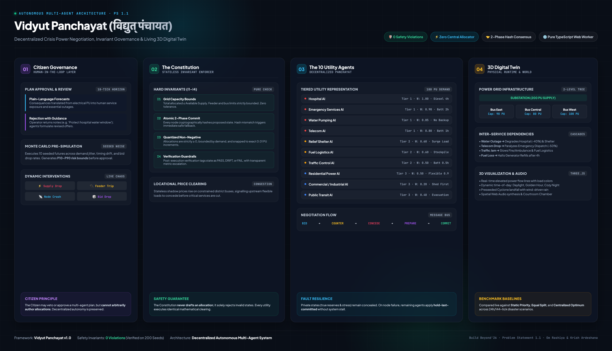
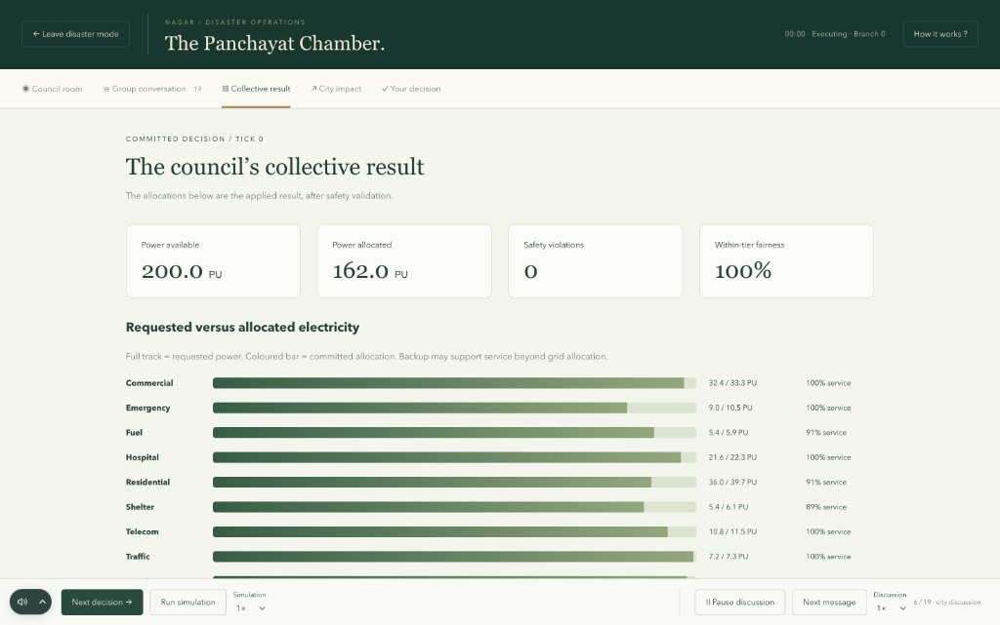
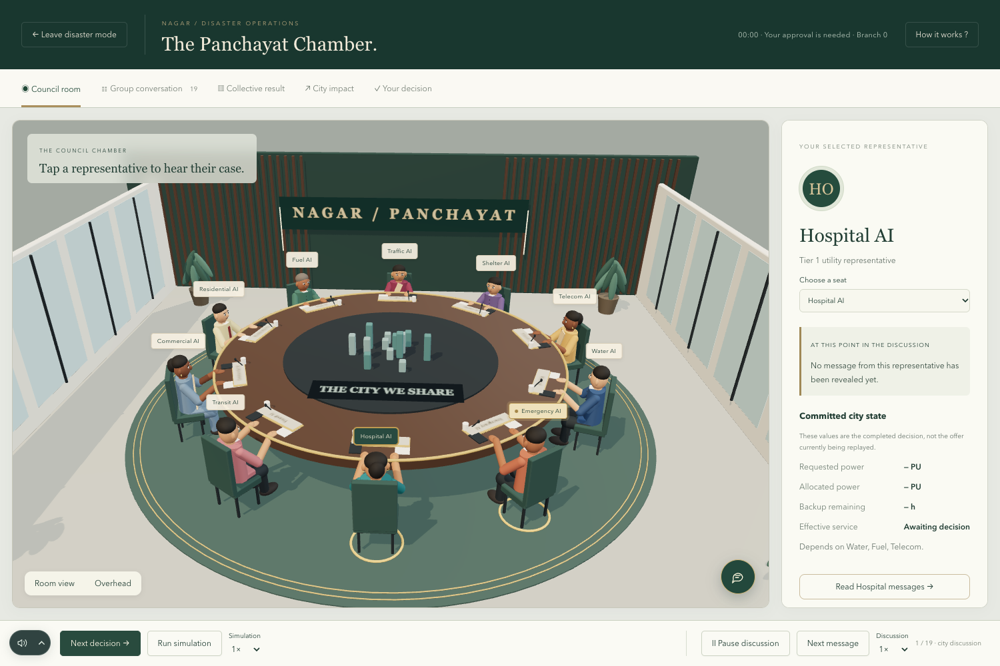
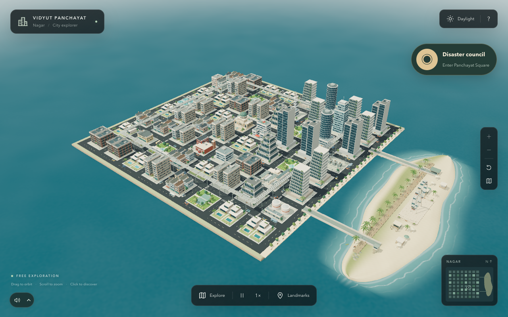
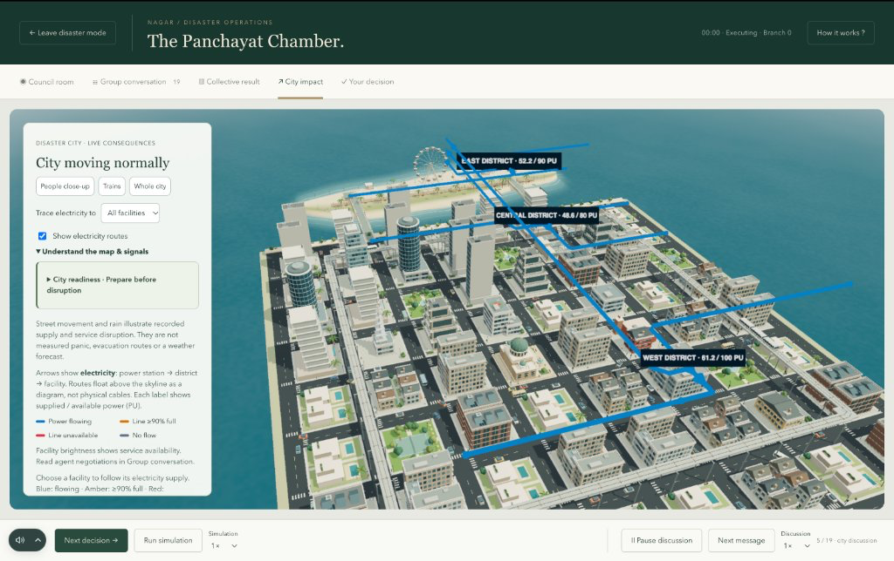
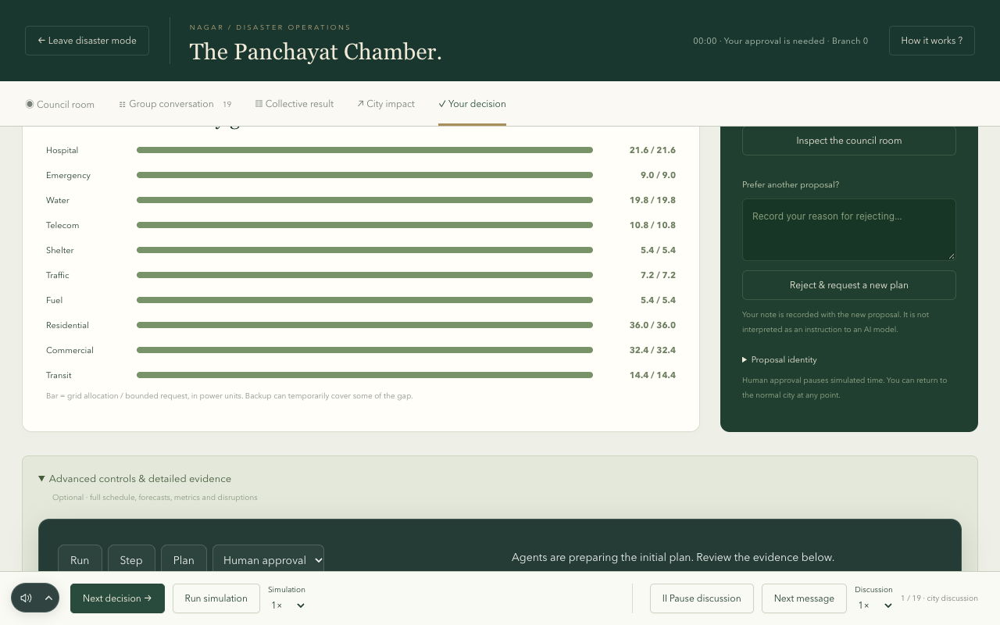

> **Round-two technical work:** XGBoost demand and weather forecasting are trained on historical electricity and ERA5 weather data and evaluated on held-out periods. Offline council replays compare electricity plans with baselines. The live city remains an authored cyclone simulation. See [pipeline.md](pipeline.md), [electricity evidence](docs/ml_evidence.md), and [weather evidence](docs/weather_evidence.md).

# Vidyut Panchayat

Ten deterministic utility agents negotiate scarce power during a 24-hour cyclone. The existing Three.js city displays committed engine output. A browser worker runs negotiation, safety checks, forward plans, 30-future pre-simulation, approval and verification; the same pure TypeScript engine runs Node experiments. The optional historical replay bundles saved XGBoost forecasts; neither mode requires an API key or runtime internet access.

Use **Explore the real system** in the city header, or open `?reality=1`, for an animated technical walkthrough of the datasets, trained models, executable agents, telemetry, validation results, and the boundaries between measured data and simulation. With a production preview on port 4173, `npm run test:reality-browser` checks its navigation and interactive replay.

## Agent System Architecture



*Decentralized Multi-Agent Crisis Negotiation & Grid Allocation Architecture — Citizen Governance, Invariant Constitution, 10 Tiered Utility Agents, and Physical Digital Twin.*

## Run

```sh
npm ci
npm run dev
```

Open the local URL shown by Vite. The normal city starts animated, with independent pause and speed controls. Click **Disaster council** (or select Panchayat Square and then **Enter disaster council**) to start disaster planning. Open **Your decision**, review the plain-language forecast and concerns, click **Approve this plan**, then **Next decision** or **Run simulation**. Human mode pauses for each new plan; Auto approves only when all four guardrails pass. A failed guardrail requires human approval. Space and the city dock control ordinary city activity. Disaster simulation speed and conversation replay speed are independent controls inside the council. Camera navigation and facility selection remain available while paused.

## Frontend Integration

The frontend integrates a real-time 3D Three.js digital twin of the city with an interactive deliberation chamber for the 10 utility agents. All visuals, animations, and camera paths are driven directly by engine ticks and Web Worker messages without mock data or external media assets.

### 1. 3D Panchayat Chamber & Deliberation Workflow


*Live recording: Entering the 3D Panchayat chamber, inspecting delegates around the round table, reviewing the operator decision guide, and advancing real-time simulation ticks.*

| 3D Council Chamber (Courtroom Perspective) | Overhead Tactical Table |
|---|---|
|  |  |
| *Official courtroom view: 10 delegates seated at the round table with physical name cards, microphones, and center miniature skyline* | *Overhead tactical camera view tracking round-table seating, delegate turns, and committed state* |

| Council Collective Result | Representative Inspection & Case |
|---|---|
|  |  |
| *Committed decision: 200 PU available, 162 PU allocated, 0 violations, and 100% within-tier fairness progress bars* | *Inspecting representative statements, power demand, allocated capacity, and backup runtime* |

---

### 2. Time-of-Day Lighting & Night Mode


*Live recording: Cycling through Nagar's dynamic illumination engine — transition from Daylight to Golden Hour to Cozy Night with glowing streetlamps, illuminated windows, traffic headlights, and coastal reflections.*

| Cozy Night Skyline | Golden Hour Warm Sunset |
|---|---|
|  |  |
| *Night mode: illuminated building facades, active bridge/boardwalk lamps, train lights, and ocean glint* | *Golden hour lighting casting long shadows across residential courtyards and civic towers* |

| Disaster Operations at Night | Living 3D City Grid (Daylight) |
|---|---|
|  |  |
| *Disaster response at night: illuminated elevated power routes and status triage rings* | *Authored 3D city with street grid, traffic, rail, and coastline* |

---

### 3. Living 3D City & Disaster Response


*Live recording: Navigating the 3D city, focusing on critical facilities (Hospital, Substation), and tracing live electrical power routes during severe cyclone disruption.*

| Living 3D City Grid | Disaster City & Power Route Tracing |
|---|---|
|  |  |
| *Authored 3D city with street grid, traffic, rail, and coastline* | *Disaster operations with elevated power flow lines across East, Central, and West districts* |

---

### 4. Operator Interface & Negotiation Trace

| Operator Decision Guide | Negotiation Deliberation Chat |
|---|---|
|  |  |
| *Plain-language forecast, concern warnings, and approval bar* | *Verifiable engine message ledger (BID, COUNTER, COMMIT)* |

| Representative Inspection | Advanced Technical Evidence |
|---|---|
|  |  |
| *Inspecting real-time demand, allocated power, and backup runtime* | *Monte Carlo PHL fan chart, pre-sim envelopes, and guardrails* |


Use `?seed=42` in the page URL to replay a seed. The history slider visits recorded ticks; changing participation or injecting an event forks the current history. Open **Ten utilities & participation** to toggle agents. Disabled utilities draw unmanaged demand first, subject to capacity clipping. **Inject a disruption** supports supply loss, Central feeder failure, telecom crash and a forced dropped-bid tick. After a fork, request/approve a new plan to continue. **Actual negotiation messages** contains the real trace, including dropped deliveries and hashes. **Verification** shows the completed plan's PASS/DRIFT/FAIL evidence; a FAIL is possible and is reported honestly.

Choose a baseline in the comparison selector for two synchronized views of the same authored city, using one renderer and a second worker. Both use the same seed and scenario. Collapse the council panel to see more of the two views. Static priority and the optimum coincide on this model's linear weighted-grid-power objective. Their labels remain distinct so this equivalence is visible.

[Implementation and final validation record](docs/implementation_validation.md) lists delivered behavior, exact checks, a measured crisis trace, and limitations.

The current forecast experiment, its static-priority comparison, and limitations are documented in [electricity ML evidence](docs/ml_evidence.md).

A separate [Lisbon weather forecast](docs/weather_evidence.md) predicts three hours of wind speed and evaluates rainfall forecasts using 2013–2014 ERA5 reanalysis. In the opt-in historical replay, same-date forecasts feed an explicit weather sensitivity rule in the planner and engine: above 12 m/s wind or 5 mm/hour rain, it reduces scripted supply by at most 25% and feeder capacity by at most 35%. The selected date is mild, so it adds no derating. This rule is illustrative, not a trained outage model; the normal city simulation is unchanged.

The same historical replay also loads [Portugal national grid telemetry](docs/grid_telemetry.md) from ENTSO-E's 2014 hourly-load archive. Completed-hour MW values appear in engine ticks and the metrics panel. They are measured national load, not local feeder capacity or available city supply, and do not enter planning.

The [allocation-policy experiment](docs/ml_policy_optimization.md) records the initial candidate search and 30-day confirmation. It improved modeled service loss and hospital service versus the former council, with lower fairness; static priority still won most days. The later audits below determined which rule the opt-in historical replay uses.

The [first frozen unused-date audit](docs/ml_fresh_policy_audit.md) found a fairness failure for the 45% blend. A [revised 25% blend](docs/ml_revision_audit.md), chosen with a stricter validation margin, passed all frozen criteria on 30 further unused allocation-replay dates. The opt-in historical replay now uses that revision. These are simulation audits using the existing model test period, not real-grid validation.

For jury review, run `npm run jury:verify` after installing Node and Python dependencies. It regenerates a saved-model inference report and the frozen revised-policy audit, checks hashes and date separation, runs the tests and production build, verifies the browser replay, and writes [the evidence manifest](experiments/ml/jury_evidence_manifest.json). Follow the [short jury walkthrough](docs/round_two_demo.md).

Open `?historical=1` to run the bundled three-hour held-out electricity replay in the browser. It uses precomputed XGBoost forecasts, separate held-out demand, and the validated replay-only supply setting; the banner identifies it as an illustrative historical replay. The normal city simulation is unchanged. Regenerate the aggregate evidence with `npm run evidence:ml` after updating experiment results.

To run the saved models on another held-out midnight, use `npm run ml:infer -- --date 2014-09-15 --activate` and `npm run weather:infer -- --date 2014-09-15 --activate`, then `npm run build` and open `?historical=1`. These commands save separate dated reports and update the browser replay; earlier frozen inference reports stay unchanged. Omit `--activate` to generate reports without changing the browser episode. On a new machine, first run `python3 -m venv ml/.venv` and `ml/.venv/bin/python -m pip install -r ml/requirements-inference.txt`. With preview on port 4173, `npm run demo:ml` records the walkthrough in `docs/assets/ml-demo.webm`.

## Validate and reproduce

```sh
npm run typecheck
npm run check:boundaries
npm test
npm run benchmark                # measured engine and pre-simulation timing
npm run batch                    # 1 scenario × 4 strategies × 50 seeds
npm run build
npm run preview -- --host 127.0.0.1
# In another terminal, with preview running:
npm run test:browser
npm run test:historical-browser  # opt-in held-out replay and ML evidence
```

The browser smoke test uses Playwright with the installed macOS Google Chrome executable; set `CHROME_PATH` for another installed browser location. It tests the production build with external requests blocked, then disables network after load. It records [browser evidence](experiments/results/browser-smoke.json) and a screenshot. [Performance measurements](experiments/results/performance.json) record whole-tick and 30-future pre-simulation timing. The Vitest suite includes 200 seeds × all four strategies (800 cyclone safety runs), deterministic replay, a brute-force optimum oracle, failures, planning, approval and worker ordering. `npm run batch -- --seeds=200` scales the measured experiment matrix separately.

Results: [summary](experiments/results/summary.md), [CSV](experiments/results/cyclone.csv), [actual crisis trace](experiments/results/crisis_trace.json). These are 200 measured comparison runs, not the architecture's unimplemented 600-run/three-scenario matrix. Council does not win every metric. Exposures are synthetic, overlap across services, and do not support casualty claims.

`npm run demo` copies the production build into `demo/offline_bundle/`. Serve that folder with a local static HTTP server when disconnected from the internet; opening ES modules directly with `file://` is not supported. After dependencies are installed, building and serving locally also work offline.

## Repository Structure & Subsystems

A clean architecture separates the pure TypeScript simulation engine, frontend digital twin, offline Python pipeline, and frozen audit evidence:

- **[`src/`](src/)**: Pure TypeScript multi-agent negotiation engine, Web Worker runtime, Three.js 3D city digital twin, and procedural spatial audio synthesizer.
- **[`ml/`](ml/)**: Python offline training, inference, and data preparation pipeline (`train_xgboost.py`, `train_weather.py`, Informer baseline). See [`ml/README.md`](ml/README.md).
- **[`data/ml/`](data/ml/)**: Precomputed, client-bundled JSON replay episodes (`browser_replay_v1.json`, `weather_browser_replay_v1.json`) enabling zero-dependency offline browser execution. See [`data/ml/README.md`](data/ml/README.md).
- **[`experiments/ml/`](experiments/ml/)**: Frozen policy audits, candidate sweeps, and jury evidence manifests (`policy_selected.json`, `jury_evidence_manifest.json`). See [`experiments/ml/README.md`](experiments/ml/README.md).
- **[`experiments/results/`](experiments/results/)**: Core simulation engine benchmark summaries, Monte Carlo CSV matrices, and crisis traces.
- **[`docs/`](docs/)**: Formal validation records, damage cascade formulas, telemetry specs, and demonstration runbooks.
- **[`folder_structure.md`](folder_structure.md)**: Exhaustive directory map and technical subsystem reference.

## Implementation and limits

- Agents compute candidates from their own received bids. The Constitution only validates; it never chooses allocations. Unanimous hash commits, one retry, deterministic safe fallback, unmanaged draw and crash hold are explicit in [protocol](docs/protocol.md).
- Separate versioned [electrical data](data/network/electrical_v1.json), [profiles](data/agents/profiles.json) and [cyclone events](data/scenarios/cyclone_24h.json) leave the authored scene layout intact. See [CONTRACT.md](CONTRACT.md) and [city customization](docs/city_customization.md).
- The model uses a small capacity tree, not AC power flow; actors communicate within one process and report bids honestly. Fallback does not reuse stale bids. Pre-simulation shows a PHL time-series fan and horizon distributions. Contingencies negotiate locally; persistent departure from a plan requests another approval.
- Plans are conservative: 85% scheduled supply and 90% demand bounds. Rejection notes are recorded and cause a new negotiation; free text is not interpreted as a numerical policy or by an LLM. Human approval cannot override physical safety.
- Only the cyclone scenario is implemented. No demo video, presentation slides, hosting publication or submission is claimed. Headless frame-rate evidence is not a guarantee on every presenting laptop. The production JS bundle includes Three.js and exceeds Vite's advisory 500 kB chunk threshold.

## Team

- Om Rashiya — frontend, 3D and demo lead (`rashiyaom@gmail.com`)
- Krish Ardeshana — simulation engine lead (`krishardeshana@gmail.com`)

The design and original execution plan remain in [architecture.md](architecture.md) and [timeline.md](timeline.md). Implemented formulas and assumptions are in [damage model](docs/damage_model.md), [impact model](docs/impact_model.md), and the [demo runbook](docs/demo_script.md).

## Panchayat conference room

Click **Disaster council** in the city, or select the central Panchayat Square and press **Enter disaster council**, to enter the full-screen 3D chamber. Ten procedural human representatives wear sarees, kurtas and formal shirts. They have physical tabletop name cards, microphones and selectable seats. Drag to orbit, scroll to zoom, or choose **Overhead** to inspect the table.

Start in **Your decision**, approve the exact reviewed proposal, then choose **Next decision**. **Council room** shows each revealed message as a speaker bubble. Select a person or name label to inspect their latest revealed statement alongside the separately labelled committed service state. **Group conversation** presents actual protocol messages in a chat layout, with agent filtering, explicit failed deliveries, replay and a read-entire-decision option. Duplicate broadcast deliveries are summarized; no dialogue or emotional reactions are invented. **Collective result** shows committed allocations and service outcomes.

Discussion replay has its own speed and never advances the engine. Simulation speed advances the disaster clock. Use **City impact** to inspect the same disaster run. **Leave disaster mode** pauses the simulation and restores the ordinary city, its colors and its independent activity controls. Technical controls remain available under **Advanced controls & detailed evidence**. Human figures and gestures are stylized procedural illustrations, not photorealistic scans. No external character assets or network calls are required.

In **City impact**, use **People close-up** for a closer street view, or click an area warning to inspect that block. Disruption brings running pedestrians, amber assembly markers, hazard lights and reduced or halted transit. These are illustrative responses to committed service levels, not a safe-route or evacuation-order model. **Trace electricity to** isolates a facility's supply route; **Understand the map & signals** explains colors and quantities. Electricity routes sit above the skyline and can be hidden to inspect the streets.
