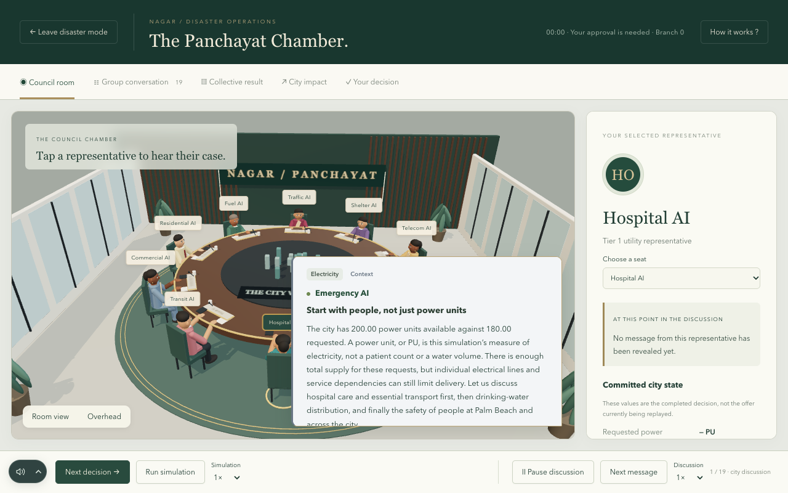
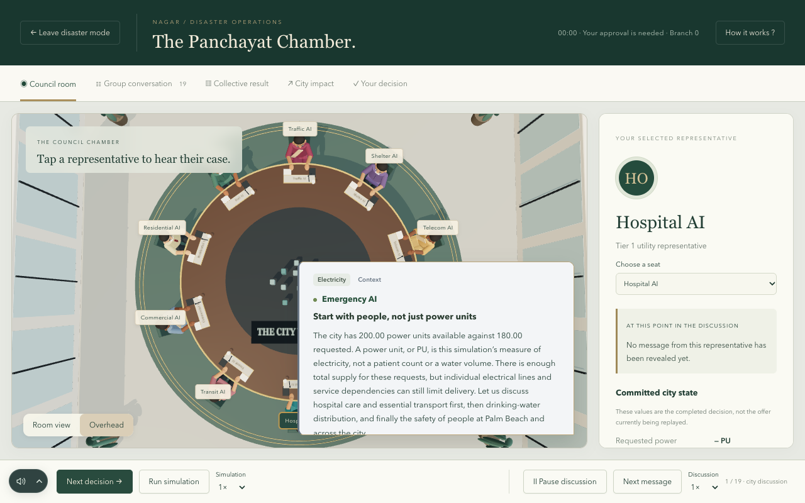
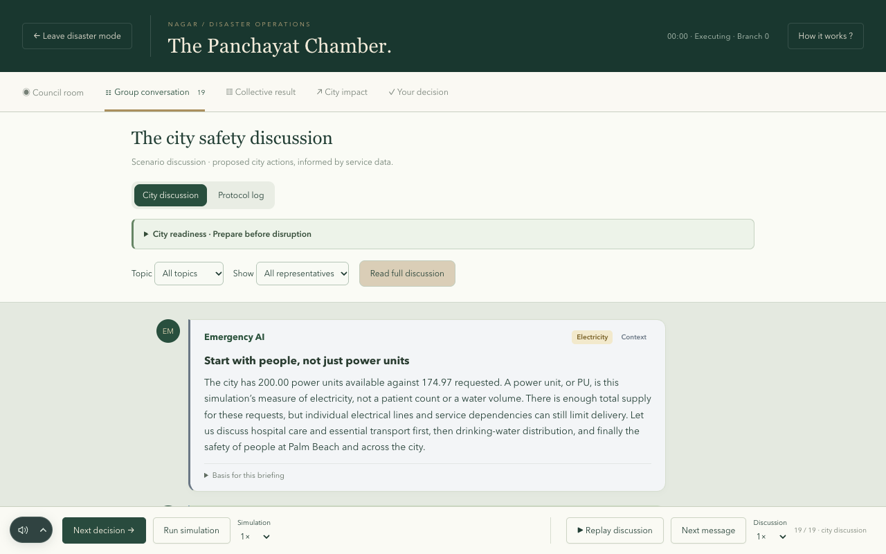

# Vidyut Panchayat

Ten deterministic utility agents negotiate scarce power during a 24-hour cyclone. The existing Three.js city displays committed engine output. A browser worker runs negotiation, safety checks, forward plans, 30-future pre-simulation, approval and verification; the same pure TypeScript engine runs Node experiments. No API key, external service, model or runtime internet access is required.

## Run

```sh
npm ci
npm run dev
```

Open the local URL shown by Vite. The normal city starts animated, with independent pause and speed controls. Click **Disaster council** (or select Panchayat Square and then **Enter disaster council**) to start disaster planning. Open **Your decision**, review the plain-language forecast and concerns, click **Approve this plan**, then **Next decision** or **Run simulation**. Human mode pauses for each new plan; Auto approves only when all four guardrails pass. A failed guardrail requires human approval. Space and the city dock control ordinary city activity. Disaster simulation speed and conversation replay speed are independent controls inside the council. Camera navigation and facility selection remain available while paused.

## Frontend Integration

The frontend integrates a real-time 3D Three.js digital twin of the city with an interactive deliberation chamber for the 10 utility agents. All visuals, animations, and camera paths are driven directly by engine ticks and Web Worker messages without mock data or external media assets.

### 1. 3D Panchayat Chamber & Deliberation Workflow


*Live recording: Entering the 3D Panchayat chamber, inspecting delegates around the round table, reviewing the operator decision guide, and advancing real-time simulation ticks.*

| 3D Chamber Perspective | Overhead Tactical Table |
|---|---|
|  |  |
| *Procedural representatives with name cards and microphones* | *Overhead camera view tracking table seating and active turns* |

---

### 2. Living 3D City & Disaster Response


*Live recording: Navigating the 3D city, focusing on critical facilities (Hospital, Substation), and tracing live electrical power routes during severe cyclone disruption.*

| Living 3D City Grid | Disaster City & Power Route Tracing |
|---|---|
|  |  |
| *Authored 3D city with street grid, traffic, rail, and coastline* | *Flooded road conditions, storm effects, and power flow arcs* |

---

### 3. Operator Interface & Negotiation Trace

| Operator Decision Guide | Negotiation Deliberation Chat |
|---|---|
|  |  |
| *Plain-language forecast, concern warnings, and approval bar* | *Verifiable engine message ledger (BID, COUNTER, COMMIT)* |

| Representative Inspection | Advanced Technical Evidence |
|---|---|
|  |  |
| *Inspecting real-time demand, allocated power, and backup runtime* | *Monte Carlo PHL fan chart, pre-sim envelopes, and guardrails* |


Use `?seed=42` in the page URL to replay a seed. The history slider visits recorded ticks; changing participation or injecting an event forks the current history. Open **Ten utilities & participation** to toggle agents. Disabled utilities draw unmanaged demand first, subject to capacity clipping. **Inject a disruption** supports supply loss, Central feeder failure, telecom crash and a forced dropped-bid tick. After a fork, request/approve a new plan to continue. **Actual negotiation messages** contains the real trace, including dropped deliveries and hashes. **Verification** shows the completed plan's PASS/DRIFT/FAIL evidence; a FAIL is possible and is reported honestly.

Choose a baseline in the comparison selector for two synchronized views of the same authored city, using one renderer and a second worker. Both use the same seed and scenario. Collapse the council panel to see more of the two views. Static priority and the optimum coincide on this model's linear weighted-grid-power objective. Their labels remain distinct so this equivalence is visible.

[Implementation and final validation record](docs/implementation_validation.md) lists delivered behavior, exact checks, a measured crisis trace, and limitations.

## Validate and reproduce

```sh
npm run typecheck
npm run check:boundaries
npm test
npm run benchmark                # measured engine and pre-simulation timing
npm run batch                    # 1 scenario × 4 strategies × 50 seeds
npm run build
npm run preview -- --host 127.0.0.1
# In another terminal, with preview running:
npm run test:browser
```

The browser smoke test uses Playwright with the installed macOS Google Chrome executable; set `CHROME_PATH` for another installed browser location. It tests the production build with external requests blocked, then disables network after load. It records [browser evidence](experiments/results/browser-smoke.json) and a screenshot. [Performance measurements](experiments/results/performance.json) record whole-tick and 30-future pre-simulation timing. The Vitest suite includes 200 seeds × all four strategies (800 cyclone safety runs), deterministic replay, a brute-force optimum oracle, failures, planning, approval and worker ordering. `npm run batch -- --seeds=200` scales the measured experiment matrix separately.

Results: [summary](experiments/results/summary.md), [CSV](experiments/results/cyclone.csv), [actual crisis trace](experiments/results/crisis_trace.json). These are 200 measured comparison runs, not the architecture's unimplemented 600-run/three-scenario matrix. Council does not win every metric. Exposures are synthetic, overlap across services, and do not support casualty claims.

`npm run demo` copies the production build into `demo/offline_bundle/`. Serve that folder with a local static HTTP server when disconnected from the internet; opening ES modules directly with `file://` is not supported. After dependencies are installed, building and serving locally also work offline.

## Implementation and limits

- Agents compute candidates from their own received bids. The Constitution only validates; it never chooses allocations. Unanimous hash commits, one retry, deterministic safe fallback, unmanaged draw and crash hold are explicit in [protocol](docs/protocol.md).
- Separate versioned [electrical data](data/network/electrical_v1.json), [profiles](data/agents/profiles.json) and [cyclone events](data/scenarios/cyclone_24h.json) leave the authored scene layout intact. See [CONTRACT.md](CONTRACT.md) and [city customization](docs/city_customization.md).
- The model uses a small capacity tree, not AC power flow; actors communicate within one process and report bids honestly. Fallback does not reuse stale bids. Pre-simulation shows a PHL time-series fan and horizon distributions. Contingencies negotiate locally; persistent departure from a plan requests another approval.
- Plans are conservative: 85% scheduled supply and 90% demand bounds. Rejection notes are recorded and cause a new negotiation; free text is not interpreted as a numerical policy or by an LLM. Human approval cannot override physical safety.
- Only the cyclone scenario is implemented. No demo video, presentation slides, hosting publication or submission is claimed. Headless frame-rate evidence is not a guarantee on every presenting laptop. The production JS bundle includes Three.js and exceeds Vite's advisory 500 kB chunk threshold.

## Team

- Om Rashiya — frontend, 3D and demo lead (`rashiyaom@gmail.com`)
- Krish Ardeshana — simulation engine lead (`krishardeshana@gmail.com`)

The design and original execution plan remain in [architecture.md](architecture.md) and [timeline.md](timeline.md). Implemented formulas and assumptions are in [damage model](docs/damage_model.md), [impact model](docs/impact_model.md), and the [demo runbook](docs/demo_script.md).

## Panchayat conference room

Click **Disaster council** in the city, or select the central Panchayat Square and press **Enter disaster council**, to enter the full-screen 3D chamber. Ten procedural human representatives wear sarees, kurtas and formal shirts. They have physical tabletop name cards, microphones and selectable seats. Drag to orbit, scroll to zoom, or choose **Overhead** to inspect the table.

Start in **Your decision**, approve the exact reviewed proposal, then choose **Next decision**. **Council room** shows each revealed message as a speaker bubble. Select a person or name label to inspect their latest revealed statement alongside the separately labelled committed service state. **Group conversation** presents actual protocol messages in a chat layout, with agent filtering, explicit failed deliveries, replay and a read-entire-decision option. Duplicate broadcast deliveries are summarized; no dialogue or emotional reactions are invented. **Collective result** shows committed allocations and service outcomes.

Discussion replay has its own speed and never advances the engine. Simulation speed advances the disaster clock. Use **City impact** to inspect the same disaster run. **Leave disaster mode** pauses the simulation and restores the ordinary city, its colors and its independent activity controls. Technical controls remain available under **Advanced controls & detailed evidence**. Human figures and gestures are stylized procedural illustrations, not photorealistic scans. No external character assets or network calls are required.
