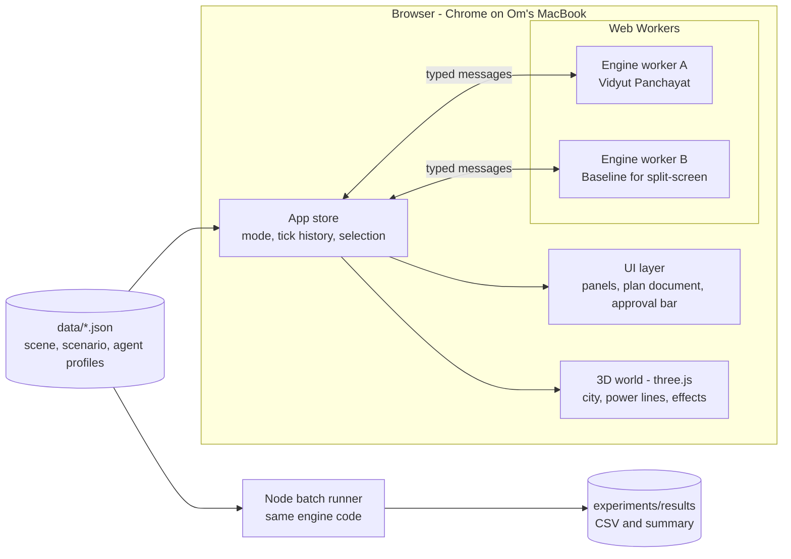
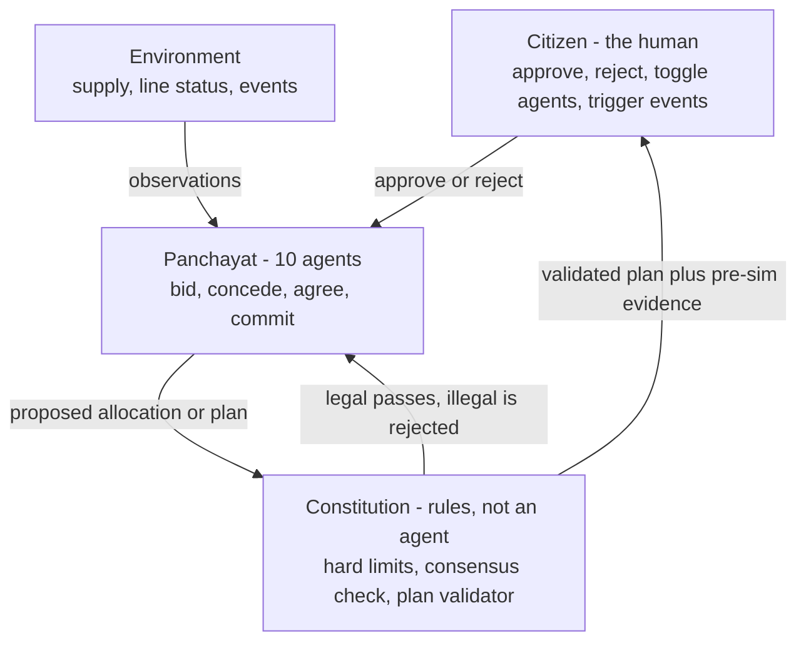
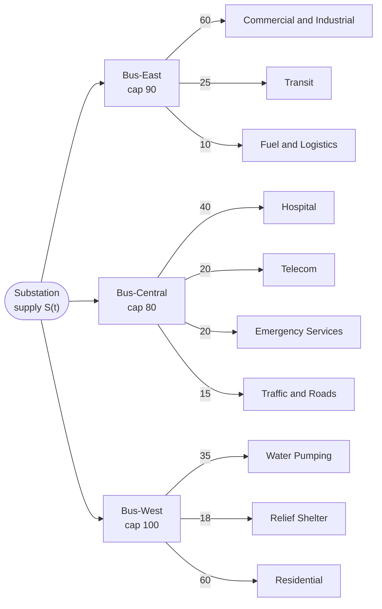
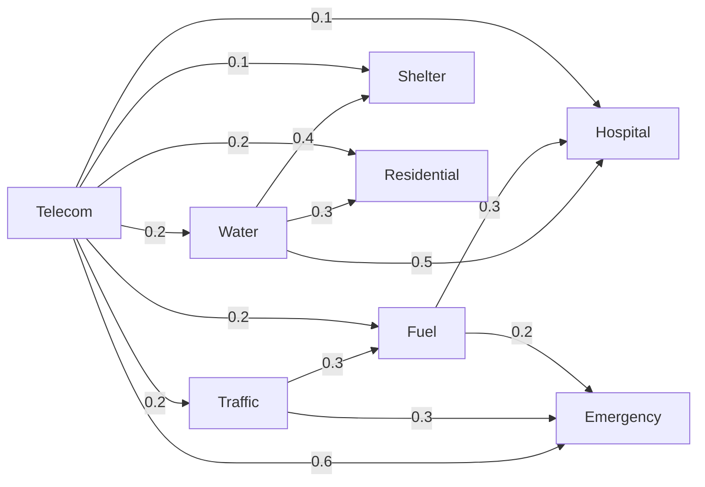
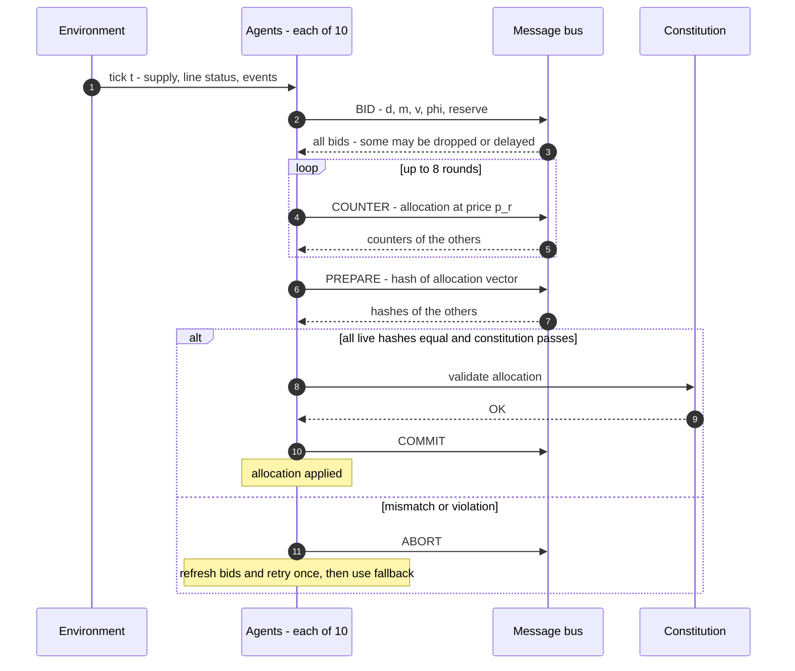
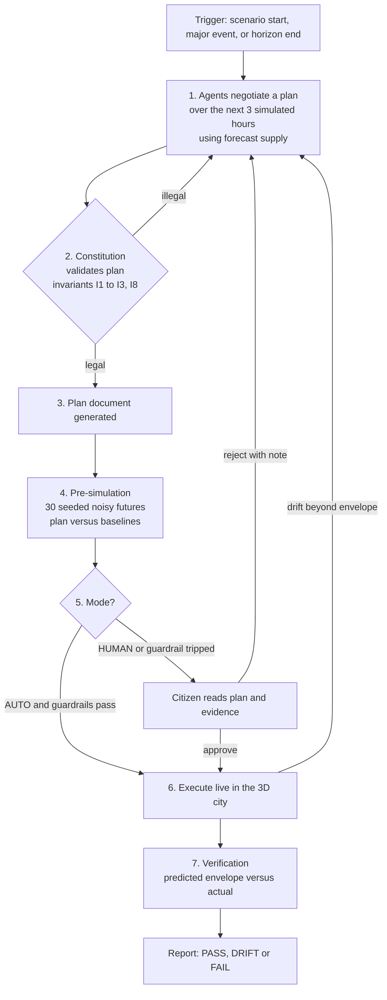
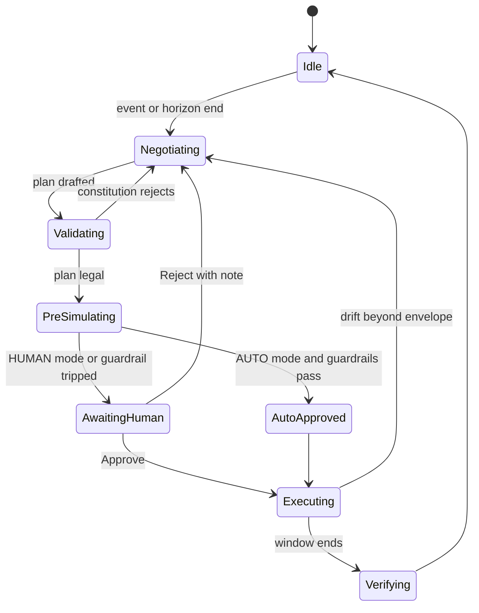
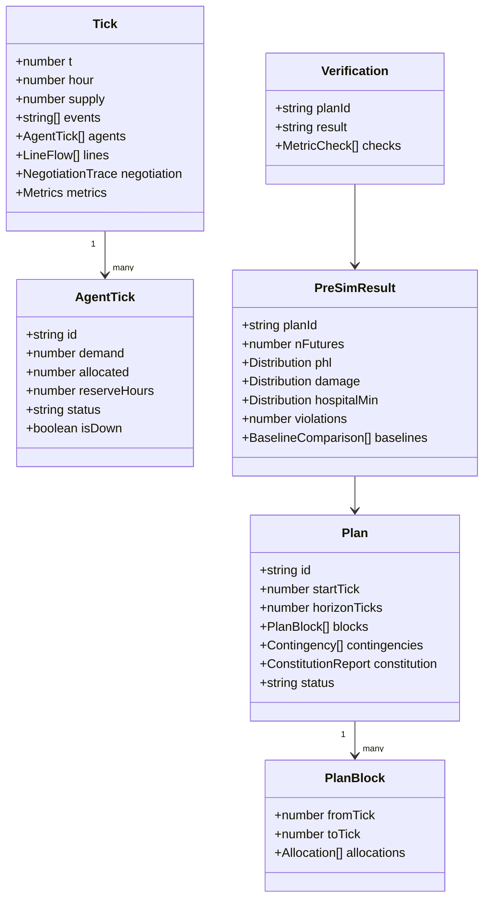

# Vidyut Panchayat (विद्युत् पंचायत)
### Decentralized Multi-Agent Negotiation for Crisis Power Allocation

| | |
|---|---|
| **Event** | Build Beyond'26, Gradient Club, AIML Dept, BMS College of Engineering |
| **Problem statement** | PS 1.1, Autonomous Multi-Agent Negotiation for Crisis Resource Allocation |
| **Team type** | **Two-participant team** |
| **Participant 1** | Om Rashiya, rashiyaom@gmail.com |
| **Participant 2** | Krish Ardeshana, krishardeshana@gmail.com |
| **Document status** | Finalized Round 1 architecture. Values marked "initial" remain subject to tuning during implementation. |
| **Companion file** | `timeline.md` (who does what, hour by hour) |

---

## Table of contents

1. [One-paragraph summary](#1-one-paragraph-summary)
2. [Problem statement to feature to proof](#2-problem-statement-to-feature-to-proof)
3. [Design principles](#3-design-principles)
4. [System overview](#4-system-overview)
5. [Governance model: Constitution, Panchayat, Citizen](#5-governance-model-constitution-panchayat-citizen)
6. [The ten agents](#6-the-ten-agents)
7. [The city and the power network](#7-the-city-and-the-power-network)
8. [Simulation engine](#8-simulation-engine)
9. [Negotiation protocol](#9-negotiation-protocol)
10. [The Constitution (hard limits)](#10-the-constitution-hard-limits)
11. [Damage, fairness and impact models](#11-damage-fairness-and-impact-models)
12. [Baselines](#12-baselines)
13. [Plan, pre-simulation, approval, verification](#13-plan-pre-simulation-approval-verification)
14. [Frontend and 3D world](#14-frontend-and-3d-world)
15. [Worker bridge and data contracts](#15-worker-bridge-and-data-contracts)
16. [Tech stack](#16-tech-stack)
17. [Repository structure](#17-repository-structure)
18. [Performance budget (8 GB MacBook)](#18-performance-budget-8-gb-macbook)
19. [Testing strategy](#19-testing-strategy)
20. [Experiments and results protocol](#20-experiments-and-results-protocol)
21. [Demo plan](#21-demo-plan)
22. [Risks and mitigations](#22-risks-and-mitigations)
23. [Scope tiers](#23-scope-tiers)
24. [Known limitations (we say these out loud)](#24-known-limitations-we-say-these-out-loud)
25. [Judge Q&A cheat sheet](#25-judge-qa-cheat-sheet)
26. [Glossary](#26-glossary)
27. [Appendix A: sample `profiles.json`](#appendix-a-sample-profilesjson)
28. [Appendix B: sample plan document](#appendix-b-sample-plan-document)

> **Viewing the diagrams.** Diagrams are written in Mermaid. GitHub renders them automatically. In VS Code, install a "Markdown Preview Mermaid Support" extension.

---

## 1. One-paragraph summary

In a disaster, a city's power supply collapses and hospitals, water pumps, telecom, emergency services and many other loads compete for what is left. Today they run independently, so power is wasted and failures cascade. **Vidyut Panchayat** gives every utility its own autonomous software agent. The ten agents negotiate in real time through bids, counter-offers and concessions, with **no central allocator**. A stateless **Constitution** layer enforces hard limits (capacity, atomic commits, consistency). Before anything executes, the agents produce a **plan document**, the system **pre-simulates** it across many noisy futures, and a **human (the Citizen)** approves or rejects it, or an **auto mode** approves it under guardrails. The approved plan then runs live in a 3D city, and a **verification** step compares what was predicted with what actually happened. Everything is measured against three baselines (static priority, equal split, centralized optimum) on seeded runs.

---

## 2. Problem statement to feature to proof

| PS 1.1 phrase | What we build | What the judge sees |
|---|---|---|
| Decentralized system, agent per utility | 10 agent objects with private state. No allocator object exists. Each agent runs the same pure clearing function on its own received bids | Kill an agent live. The rest keep negotiating |
| Negotiate in real time through bids, priorities, concessions | `BID`, `COUNTER`, `CONCEDE`, `ACCEPT` messages over a message bus. Concession curve driven by priority, urgency and flexibility | Live negotiation feed and bid arcs between buildings |
| Fluctuating power supply | Scenario with grid collapse, partial restoration, feeder failure, forecast error | Supply chart in the HUD, timeline scrubber with event markers |
| Hard capacity limits | Constitution invariants I1 to I4, checked every tick | **"Violations: 0"** counter and "Blocked by Constitution: n" counter |
| Avoid inconsistent states | Two-phase commit with hash consensus. Abort leads to a safe fallback | Abort and fallback counters, test that drops messages |
| Balance priority against fairness | Value function (priority x urgency) plus tiered Jain's fairness index plus rotation for general loads | Fairness gauge, rotating-outage visual |
| Minimize total damage | Damage model with lagged cascades, plus person-hours of essential-service loss | Split-screen against baselines and a batch results table |
| Simulated multi-hour disaster | 24 simulated hours, 144 ticks of 10 minutes | Scrubbable timeline |

---

## 3. Design principles

1. **Decentralization is real or it is nothing.** Agents exchange messages. No module holds global allocation authority. The Constitution can reject a state but never create one.
2. **Safety is an invariant, not a metric.** Capacity is never exceeded, and we show it live.
3. **Determinism.** The same scene, scenario, seed, strategy and toggles always produce the same log. This makes the demo reproducible and the results table credible.
4. **The engine is pure TypeScript.** No DOM, no globals. It runs in a Web Worker in the browser and in Node for batch experiments.
5. **The frontend is a renderer of ticks.** It never decides anything. It plays what the engine emits.
6. **Contract first.** Types and JSON schemas are fixed in hour 1. Both of us build against them.
7. **Evidence over animation.** Every claim on a slide traces to a batch run.
8. **Honest labeling.** Synthetic populations and modelled impact are labeled as such, everywhere.

---

## 4. System overview



**Runtime shape.** There is no server. The demo is a static site. All simulation happens in Web Workers on the presenting laptop, so there is no network dependency on stage.

---

## 5. Governance model: Constitution, Panchayat, Citizen

We use one metaphor only: a village council of equals.



| Layer | Can allocate power? | Can veto? | Fails how? |
|---|---|---|---|
| **Panchayat (agents)** | **Yes.** Decisions take effect once committed | No | One agent crashing does not stop the rest (hold-last rule, section 9.7) |
| **Constitution** | **No** | **Only illegal states** | Stateless. Every agent can run the same check |
| **Citizen (human)** | No | Rejects plans in human mode | If absent, the previous safe plan keeps running (with a timeout in a real deployment) |

**There is deliberately no "prime minister" agent and no appeal council.** A top-down verdict would be a central controller and would contradict the problem statement. An appeal council is listed as future work (section 24).

---

## 6. The ten agents

Default: all ten are active. The minimum recommended set is the first eight (without Fuel and Transit). Every agent can be toggled from the UI.

| # | Agent | Tier | Priority weight W | Normal demand d (PU) | Min viable m (PU) | Backup | Flexibility φ (0 to 1) | Role in the story |
|---|---|---|---|---|---|---|---|---|
| 1 | **Hospital** | 1 Critical | 1.00 | 24 | 17 | Diesel, 4 h | 0.1 | Highest stakes. Demand +40% in the surge |
| 2 | **Emergency Services** (fire, police, ambulance dispatch) | 1 | 0.90 | 10 | 6 | Battery, 2 h | 0.2 | Effectiveness depends on telecom and traffic |
| 3 | **Water Pumping** | 1 | 0.85 | 22 | 12 | None | 0.3 | Hospital and shelter depend on it |
| 4 | **Telecom** | 1 | 0.80 | 12 | 7 | Battery, 1 h | 0.2 | Short reserve, hidden dependency for many |
| 5 | **Relief Shelter** | 2 Essential | 0.60 | 6 (rises to 14 on evacuation) | 3 | None | 0.5 | Load grows as people arrive |
| 6 | **Traffic and Roads** | 2 | 0.50 | 8 | 3 | Battery, 0.5 h | 0.6 | Signal failure slows ambulances |
| 7 | **Fuel and Logistics** | 2 | 0.60 | 6 | 3 | Stockpile (non-electric) | 0.3 | Hospital diesel refill depends on it |
| 8 | **Residential** | 3 General | 0.50 | 40 | 10 | None | 0.9 | Largest demand. The fairness voice |
| 9 | **Commercial and Industrial** | 3 | 0.20 | 36 | 0 | Captive generators, 3 h partial | 1.0 | First to shed. Its shedding makes the system work |
| 10 | **Transit** | 3 | 0.40 | 16 | 4 | None | 0.7 | Large load, enables evacuation |

Sums: normal demand = **180 PU**, total minimum viable = **65 PU**. All values are **initial** and live in `data/agents/profiles.json`.

**Why these ten.** An agent earns a place only if it differs from the others in at least three of: priority, backup reserve, flexibility, who depends on it, and the type of damage when it fails. Agents 8 and 9 (Residential, Commercial and Industrial) are essential. Without flexible, sheddable loads the negotiation is just critical services fighting over scraps.

**Not agents.** The grid operator (supply, line status) is the *Environment*. It publishes numbers and has no needs.

**Private versus shared information.** An agent's true reserve, true criticality and strategy are private. Only what it puts in its `BID` becomes shared.

**What toggling an agent off means.** A disabled agent leaves the panchayat but its facility stays in the city as an **unmanaged load**. It draws its full demand first, before negotiation (clipped by line capacity and available supply, scaled proportionally if supply is short). This models uncontrolled draw in today's grids and makes the value of participation visible: *toggle Residential off and watch it grab power*. This is a modelling assumption and is stated on screen.

---

## 7. The city and the power network

### 7.1 Layout

An 8 x 8 grid, hand-authored, deliberately asymmetric so cascades are legible. This is the **initial layout**. Final coordinates live in `data/scenes/city_v1.json` and may shift in the first hours.

```
        c0   c1   c2   c3   c4   c5   c6   c7
  r0 |  RS   RS   RS   ..   ..   CI   CI   CI
  r1 |  RS   RS   PK   ..   TL   CI   CI   CI
  r2 |  ..   RS   ..   ..   ..   PK   CI   ..
  r3 |  WA   ..   ..   ..   HO   ..   ..   SS
  r4 |  RS   RS   ..   ..   ..   ..   PK   ..
  r5 |  RS   RS   ..   EM   TR   ..   TM   ..
  r6 |  RS   SH   PK   ..   ..   ..   ..   FU
  r7 |  RS   RS   ..   ..   ..   PK   ..   ..
```

`SS` substation, `HO` hospital, `EM` emergency HQ, `WA` water pumping, `TL` telecom tower, `SH` shelter, `TR` traffic control, `FU` fuel depot, `TM` transit hub, `RS` residential, `CI` commercial and industrial, `PK` park, `..` seeded procedural filler (mixed houses and shops).

The hospital is 3 cells from the substation and water is 7. The audience sees who is squeezed first.

### 7.2 Power network (hard capacities)

A two-level tree. The buses create shared contention, which is what makes locational pricing (section 9.4) meaningful.



Because the network is a tree (a laminar family of capacity constraints), a greedy fill by weight is the **exact** optimum for the centralized baseline. A general LP library is only needed if we add redundant loop edges (stretch).

### 7.3 Dependency graph (cascade)

An arrow `A -->|w| B` reads: *B's service degrades by w times A's shortfall.*



The graph is acyclic. Cascade uses the **previous tick's** service level, so failures ripple with a visible delay, and a cyclic dependency would not break the model.

### 7.4 Scenario `cyclone_24h` (initial)

144 ticks of 10 minutes.

| Time | Event | Supply (PU) | Effect |
|---|---|---|---|
| 0 h | Normal operation | 200 | Surplus of 20 PU |
| 2 h | **Grid collapse** | 70 | Barely above the 65 PU minimum viable |
| 6 h | Partial restoration | 110 | |
| 8 h | **Hospital surge** (+40% demand) and shelter load grows | 110 | Hospital demand 24 to ~34 PU |
| 9 h | **Bus-Central feeder failure** (cap 80 to 30) and supply drop | 55 | Below minimum viable, so the **triage ladder** fires. Four critical agents share one bus |
| 11 h | Fuel depot flooded (only if Fuel is enabled) | 55 | Hospital diesel refill stops |
| 14 h | Restoration | 120 | |
| 18 h | **Telecom agent crashes** for 30 min (3 ticks) | 120 | Proves decentralization (hold-last rule) |
| 22 h | Near recovery | 170 | |

```
Supply (PU) - each block = 10 PU
 0h   200  ████████████████████
 2h    70  ███████
 6h   110  ███████████
 9h    55  ██████            <- feeder failure plus triage
14h   120  ████████████
22h   170  █████████████████
```

Seeded randomness (so 50 seeds are genuinely different): demand noise ±10%, message drop probability 0% to 5%, event timing ±30 minutes.

Additional scenarios (stretch): `substation_failure`, `agent_crash`.

---

## 8. Simulation engine

### 8.1 Time model

- 24 simulated hours, tick = 10 minutes, 144 ticks. Δt = 1/6 hour.
- The engine is a **pure function of (scene, scenario, profiles, seed, strategy, toggles)**.

### 8.2 Tick pipeline

```
for each tick t:
  1  env.advance(t)              // supply, bus capacities, events (seeded)
  2  reserves.update(t-1)        // deplete or refill from last committed allocation
  3  agents.observe()            // each agent updates its private state
  4  if plan.trigger(t) or no plan: negotiate(t)
     else:                       use planned allocation (agents re-validate)
  5  constitution.validate()     // must pass, else fallback
  6  apply allocation -> service levels -> lagged cascade -> damage
  7  metrics.record(); recorder.push(tick)
```

### 8.3 Reserve model

- Backup substitutes for a grid shortfall at a proportional rate. With deficit fraction f = 1 - a/d, the reserve drains f x Δt hours per tick, and while reserve > 0, backup covers the deficit.
- Reserves recharge at ρ hours per hour while grid service is at least 95%. Diesel-based reserves (hospital, commercial) additionally require Fuel and Logistics service of at least 50%.

### 8.4 Determinism rules

- A seeded PRNG (`mulberry32`) in `engine/rng.ts`. **No `Math.random`, no `Date.now` inside `engine/`** (enforced by a lint rule).
- Stable iteration order (sorted agent ids, never object key order).
- The consensus hash is computed over allocations **quantized to 0.01 PU** so floating-point noise cannot cause false mismatches.

---

## 9. Negotiation protocol

### 9.1 Messages

| Type | Sender to receiver | Payload | Purpose |
|---|---|---|---|
| `BID` | agent to all | demand d, minimum viable m, value v, flexibility φ, reserve hours, `note` | Opens a tick |
| `COUNTER` | agent to all | allocation a_i the agent would accept at price p_r | One per round |
| `CONCEDE` | agent to all | a `COUNTER` lower than the previous round, plus a reason (for example "generator covers 4 h") | Drives UI speech bubbles |
| `ACCEPT` | agent to all | accepted clearing price | Final round |
| `PREPARE` | agent to all | hash of the full allocation vector the agent computed | Phase 1 of commit |
| `COMMIT` | agent to all | the hash | Phase 2, only if all live hashes match and the Constitution passes |
| `ABORT` | agent to all | reason | Mismatch, violation or timeout |
| `HEARTBEAT` | agent to all | tick | Crash detection |

### 9.2 Per-agent value (willingness to hold power)

```
urgency_i   = 1 + 2 x (1 - min(reserveHours_i, 4) / 4)        // in [1, 3]
depStress_i = Σ_j w_ij x (1 - s_eff_j(t-1))                   // shortfall of what i depends on
v_i         = W_i x urgency_i x (1 + 0.5 x depStress_i)
```

An agent with a long reserve concedes more. An agent whose dependencies are failing becomes more insistent.

### 9.3 Concession curve

At price p, agent i is willing to take:

```
a_i(p) = m_i + (d_i - m_i) x clamp( (v_i / p)^λ_i , 0, 1 )
λ_i    = 1 + 2 x φ_i
```

- While p ≤ v_i the agent holds its full demand.
- Above that it concedes toward its minimum viable m_i. A larger flexibility φ gives faster concession.
- a_i(p) is monotonically non-increasing in p. This guarantees the price search converges.

### 9.4 Price clearing with locational prices

This mirrors **locational marginal pricing (LMP)**, the mechanism real electricity markets use to price congestion.

1. **Bus price.** For each bus b, find the lowest price p_b ≥ 0 such that Σ_{i in b} a_i(p_b) ≤ cap_b. If the bus is uncongested, p_b = 0.
2. **Root price.** Find the lowest root price p such that
   `Σ_b Σ_{i in b} a_i( max(p, p_b) ) ≤ S_t`.
3. Each agent receives `a_i( max(p, p_b(i)) )`.

Both searches are **bisection**, one round of messages per iteration (maximum 8 rounds). At termination the algorithm always selects the **upper bound** (the feasible side), so the result is feasible by construction even if it has not fully converged.

A congested bus therefore sees a **higher local price**. The UI shows this as a hot bus line.

### 9.5 Triage ladder (when minimums cannot be met)

If Σ m_i > S_t or Σ m_i > a bus cap, the minimum viable guarantee cannot hold. Agents are dropped from their minimum in ascending order of v_i (lowest value first), down to 0 if necessary, until feasible. The ladder is a deterministic function of the bids, so every agent computes the same ladder. The event is logged and highlighted ("Triage: Transit and Commercial shed").

### 9.6 Fairness correction (rotation)

After clearing, if a **general-tier** agent (Residential, Commercial, Transit) has been below 50% service for more than 2 consecutive hours while another general-tier agent is above 80%, the next negotiation applies a rotation bias that raises the starved agent's value by a bounded factor. Residential outages are shown as rotating blocks rather than one permanently dark district.

### 9.7 Atomic commit and failure handling



Every agent computes the clearing from **its own view** of the bids it received. Under normal conditions all views are identical, so all hashes match. When messages are dropped, views diverge, hashes differ, and the commit aborts. That is the mechanism that prevents two agents from acting on contradictory allocations.

| Failure | Detection | Response | Invariant preserved |
|---|---|---|---|
| Dropped `BID` | Missing bid, then hash mismatch | Use last known bid (stale, at most 2 ticks), `ABORT`, rebroadcast, retry once | I5 atomicity |
| Delayed message | Tick barrier | Messages after the barrier are ignored until the next tick | Determinism |
| Agent crash | 2 missed heartbeats | Mark `DOWN`. **Hold-last rule**: its last committed allocation is held (clipped to feasibility) and the others re-clear over what remains. Rejoins with a fresh `BID` | I1 to I3, no blackout of a critical facility by a software crash |
| Non-convergence | Round cap reached | Take the feasible upper price | I1 to I3 |
| Constitution rejects | Validator fails | Fallback: last committed allocation projected onto current constraints by the triage ladder | I6 safe fallback |
| Mid-plan line failure | Event trigger | Local renegotiation, then replan if drift persists | I2 |

---

## 10. The Constitution (hard limits)

A stateless validator, `engine/constitution/invariants.ts`, run on every tick and on every plan.

| ID | Invariant | Checked |
|---|---|---|
| **I1** | Σ allocations ≤ supply S_t | Every tick, every plan block |
| **I2** | For every bus and feeder: flow ≤ capacity (0 if failed) | Every tick, every plan block |
| **I3** | 0 ≤ a_i ≤ min(d_i, feeder capacity) | Every tick |
| **I4** | 0 ≤ reserve ≤ reserve capacity | Every tick |
| **I5** | An allocation is applied only after a `COMMIT` with unanimous live hashes | Every tick |
| **I6** | On abort or failure, the applied allocation still satisfies I1 to I3 | Every tick |
| **I7** | Same (scene, scenario, seed, strategy, toggles) gives a byte-identical log | Test suite |
| **I8** | Plan legality: I1 to I3 hold for every plan block under the **pessimistic supply forecast** and for every contingency branch | Plan validator |

**Two counters on the HUD.**
- **Violations: n** counts illegal states that *reached the applied state*. This must always be **0**.
- **Blocked by Constitution: n** counts illegal proposals *rejected before application*. It shows the layer doing real work.

The Constitution cannot allocate. In the simulation it is one module for clarity, but nothing in it needs central state, so every agent could embed it.

---

## 11. Damage, fairness and impact models

### 11.1 Service and cascade

```
backupFrac_i(t) = f_i(t)  if reserve_i(t) > 0 else 0,     f_i = max(0, 1 - a_i/d_i)
s_i(t)          = min(1, a_i/d_i + backupFrac_i)                       // own service
s_eff_i(t)      = s_i(t) x Π_j ( 1 - w_ij x (1 - s_eff_j(t-1)) )       // lagged cascade
```

### 11.2 Damage

```
harm_i(t) = W_i x (1 - s_eff_i(t))^γ x Δt          // γ = 1.5 initial: deep outages hurt more
D         = Σ_t Σ_i harm_i(t)                       // headline damage score
```

### 11.3 Impact metrics (what we put on slides)

We **do not claim "lives saved"**. A modelled number presented as real would not survive a judge's question. We report:

| Metric | Definition | Why it is defensible |
|---|---|---|
| **PHL, person-hours of essential-service loss** | Σ_t Σ_i exposure_i x (1 - s_eff_i(t)) x Δt | Transparent formula, per-service, synthetic exposure labeled as such |
| **Critical-service uptime** | Fraction of ticks Tier-1 agents have s_eff ≥ 0.9 | Directly observable |
| **Hospital minimum service** | min over t of s_eff_hospital | Worst moment, not just an average |
| **Damage score D** | Section 11.2 | Priority-weighted |
| **Reduction versus baseline** | (metric_baseline - metric_ours) / metric_baseline | A relative claim, not an absolute one |

`exposure_i` (persons whose essential service depends on agent i) is synthetic and set in `profiles.json`. Counting each service separately means one person can appear in more than one agent's exposure. This is stated on the slide.

### 11.4 Fairness

**F = Jain's index of service ratios computed within each tier, averaged across tiers weighted by tier demand.** Priority is *intentionally* unequal across tiers, so fairness is measured *within* a tier. Jain's index for ratios x_i is (Σ x_i)² / (n Σ x_i²). A value of 1 means perfectly equal.

---

## 12. Baselines

| Baseline | Rule | What it represents | Caveat |
|---|---|---|---|
| **Static priority** | Fixed order by priority, allocate until supply is exhausted, honoring line caps, ignoring reserves | Rulebook-based operation today | Starves low tiers entirely |
| **Equal split** | Equal share, cap at demand, redistribute the unused share (water-filling) | "Fair" but blind to criticality | Wastes power on non-critical loads |
| **Centralized optimum** | Per tick, maximize Σ W_i a_i under I1 to I3 with full information (exact greedy on the tree) | Upper bound for **one-tick weighted service** | A single point of failure. **Myopic**, so negotiation can beat it on cumulative PHL because agents price in reserve depletion. We report both honestly |

Metrics for the comparison table: PHL, damage D, critical uptime, hospital minimum service, fairness F, violations, gap to the optimum on weighted service.

---

## 13. Plan, pre-simulation, approval, verification

### 13.1 Workflow



**Order note.** Pre-simulation runs **before** approval, so the human decides with the evidence in front of them. That gives one approval, not two.

### 13.2 Plan

- **Horizon:** 3 simulated hours (18 ticks), replanned at each major event or when the horizon ends.
- **Content:** a schedule of committed allocation vectors in 30-minute blocks, computed by running the negotiation forward over **forecast** supply and expected demand (no noise), plus **contingency rules**.
- **Contingency triggers:** supply deviates more than 15% from forecast, an agent's reserve falls below its threshold (default 1 hour), a line fails, or an agent crashes. A trigger causes local renegotiation under the same Constitution. Persistent drift causes a replan.
- **Execution:** each tick, agents re-validate the plan. If no trigger fired they commit the planned allocation (cheap). Otherwise they negotiate. This yields a **plan adherence** metric.

### 13.3 Pre-simulation

- N = 30 futures by default. Each future perturbs demand (±10%), forecast error (±15%), message drops (0% to 5%) and event timing (±30 min), with seeds `1000 + k`.
- Run for the plan **and** the baselines, over the plan horizon.
- Output: p10, p50, p90 and min/max of PHL, damage D, hospital minimum service, fairness F, and the **number of violations (must be 0 in every future)**.
- Displayed as a **fan chart** (p10 to p90 band with the p50 line) drawn in canvas. No charting library.
- Runs in the worker and streams progress so the UI never blocks.

### 13.4 Modes and guardrails



**Auto mode guardrails.** Auto-approval requires all of the following. Otherwise the plan **escalates to the human**.

1. The Constitution passes (I1 to I3, I8).
2. Zero violations in all pre-sim futures.
3. p50 PHL of the plan is no worse than the best baseline's p50.
4. p10 hospital minimum service is at least 0.8.

**Human mode.** The simulation clock pauses at the plan screen. In a real deployment the *previous safe plan would keep running* until the human responds, with a timeout to a safe default. We say this on stage.

### 13.5 Verification

After the plan window, compare actual outcomes with the pre-sim envelope for each headline metric.

| Result | Rule | Action |
|---|---|---|
| **PASS** | Actual within [p10, p90] for all headline metrics | Report |
| **DRIFT** | Outside [p10, p90] but within [min, max] | Human mode asks for a replan. Auto mode replans |
| **FAIL** | Outside [min, max] | Escalate to the human, replan |

Live execution deliberately uses a **different seed** from the pre-sim, and the demo can inject a surprise event. The verification panel reports a line such as *"Predicted PHL 1,200 to 1,600, actual 1,380, PASS"* (example format, not a result).

### 13.4b Plan document contents

Summary of the decision and reasons, allocation per agent per block, who concedes what, contingencies, Constitution report, pre-sim evidence against baselines, and the approval record. See Appendix B.

---

## 14. Frontend and 3D world

### 14.1 Principles

- Vite plus TypeScript plus three.js. No React.
- The frontend **renders ticks and never decides**.
- Tick history is stored on the main thread, so scrubbing backward needs no re-simulation. Changing a toggle or triggering an event **forks the timeline** from the current tick and discards later history.

### 14.2 World construction

1. Load `scene.json`, validate with zod.
2. Ground plane, road grid.
3. Facilities from **Kenney City Kits** (CC0, glTF) where a suitable model exists. Landmarks that have no model are built from primitives with a distinct silhouette, color, and glow marker. *Check the kit previews on day 0.*
4. Filler buildings and parks generated by a **seeded** script by district type, rendered with `InstancedMesh`.
5. Power lines between substation, buses and facilities.

### 14.3 Visual language

| Signal | Encoding |
|---|---|
| Service status | Green full, amber rationed, red critical, black down. **Icons and labels as well as color** so it never relies on color alone |
| Allocated power | Line thickness equals allocation divided by capacity |
| Flow | Particles along lines. Speed equals utilization |
| Congested bus | Line glows hot with the local price shown |
| Negotiation | Arcs between buildings for bids and counters, speech-bubble snippets for concessions |
| Cascade | Expanding ripple from the failed facility along dependency edges, with a one-tick delay |
| Blackout | Flicker, then dimming, then a dark facility. Optional bloom |
| Crashed agent | Facility ring turns grey. A "HOLD" badge appears |

### 14.4 UI panels

| Panel | Purpose | Data |
|---|---|---|
| **Metrics HUD** | PHL, damage, fairness, **Violations: 0**, **Blocked: n**, rounds, aborts and fallbacks | `tick.metrics` |
| **Timeline** | Scrubber with event markers, supply sparkline | History |
| **Negotiation feed** | Messages as a readable ticker | `tick.negotiation` |
| **Agent toggles** | Enable or disable each agent | Store, forks timeline |
| **Event buttons** | Trigger grid collapse, feeder failure, agent crash | Worker |
| **Plan document** | Render the plan as a readable document | `Plan` |
| **Approval bar** | Approve or Reject (with note), mode switch Auto or Human | State machine |
| **Pre-sim panel** | Fan chart, comparison against baselines | `PreSimResult` |
| **Verification panel** | Predicted envelope versus actual, PASS, DRIFT or FAIL | `Verification` |
| **Presenter mode** | Large fonts, no debug, camera presets | Store |

Keyboard: `Space` play or pause, `←`/`→` step, `1`-`4` camera presets, `M` mode, `D` trigger disaster, `S` split-screen, `P` presenter mode.

### 14.5 Split-screen

Two engine workers (A: Vidyut Panchayat, B: a baseline, default static priority) run the **same scenario and seed** in **lockstep**. The main thread owns one clock, sends `STEP` to both, and renders after both reply. Rendering uses **one `WebGLRenderer` with two scenes and scissor viewports**, which uses less memory than two renderers. The baseline can be switched to equal split, and the centralized optimum can be shown as a "ghost" metric.

---

## 15. Worker bridge and data contracts

### 15.1 Messages

| Direction | Message | Payload |
|---|---|---|
| Main to worker | `INIT` | sceneId, scenarioId, seed, enabledAgents, strategy |
| | `RUN` / `PAUSE` / `STEP` | speed or tick index |
| | `SEEK` | tick (served from history, resumes simulation beyond it) |
| | `TOGGLE_AGENT` | id, enabled (forks timeline) |
| | `TRIGGER_EVENT` | event type |
| | `SET_MODE` | `auto` or `human` |
| | `REQUEST_PLAN` | horizonTicks |
| | `REQUEST_PRESIM` | planId, nFutures |
| | `APPROVE` / `REJECT` | planId, note |
| Worker to main | `TICK` | one `Tick` |
| | `PLAN_READY` | `Plan` |
| | `PRESIM_PROGRESS` / `PRESIM_DONE` | progress or `PreSimResult` |
| | `PLAN_STATE` | state-machine state |
| | `VERIFICATION` | `Verification` |
| | `ERROR` | message |

### 15.2 Core types



`status` is one of `ok | rationed | critical | down`. All types live in `src/contract/types.ts` with matching zod schemas, and **every JSON file and every message is validated at the boundary**, so a mismatch fails loudly instead of rendering a blank scene.

**Change rule:** any change to `src/contract/` or `data/` is announced in chat, logged in `CONTRACT.md`, and reviewed by the other person.

---

## 16. Tech stack

| Area | Choice | Why |
|---|---|---|
| Language | **TypeScript** everywhere | One language, compile-time contract checking, runs in browser and Node |
| Bundler / dev server | Vite | Fast, native Worker support (`new Worker(new URL(...), { type: 'module' })`) |
| 3D | three.js (GLTFLoader, OrbitControls, EffectComposer plus bloom, InstancedMesh) | Core of the demo |
| Animation | GSAP | Camera moves and UI transitions |
| Validation | zod | Boundary checks for JSON and messages |
| Tests | vitest | Same toolchain as Vite |
| Node scripts | tsx | Runs `scripts/batch.ts` against the same engine |
| Debug UI | lil-gui | Dev only, removed before demo |
| Asset tooling | `@gltf-transform/cli` | Compress `.glb` models |
| Charts | Hand-written canvas helper | No dependency, about 100 lines |
| Optimum baseline | Greedy on the tree (exact). LP library only if we add loops | Fewer dependencies |

Versions are pinned by `package-lock.json`. We do not copy version numbers from documentation. **No** backend, database, Docker, cloud service, GPU, ML framework or API key is required.

> A learned concession strategy (reinforcement learning, trained on Colab) is *not* in scope. If time remained it would be exported as a small weights file. Nothing in the core design depends on it.

---

## 17. Repository structure

```
vidyut-panchayat/
├── README.md
├── package.json              # scripts: dev, build, preview, test, typecheck, batch, demo
├── tsconfig.json  vite.config.ts  index.html
├── CONTRACT.md               # field meanings and changelog
├── data/
│   ├── scenes/city_v1.json
│   ├── scenarios/cyclone_24h.json  (+ substation_failure.json, agent_crash.json)
│   └── agents/profiles.json
├── public/models/            # Kenney .glb files
├── src/
│   ├── contract/             # types.ts + zod schemas
│   ├── engine/               # pure TS, NO DOM. Runs in Worker and Node
│   │   ├── rng.ts  world.ts  clock.ts  events.ts  dependencyGraph.ts  damage.ts
│   │   ├── agents/           # baseAgent.ts, valueFunction.ts, concession.ts
│   │   ├── protocol/         # messages.ts, bus.ts, clearing.ts, triage.ts,
│   │   │                     #   negotiation.ts, twoPhaseCommit.ts
│   │   ├── constitution/     # invariants.ts, planValidator.ts
│   │   ├── policy/           # fairness.ts, rotation.ts
│   │   ├── baselines/        # staticPriority.ts, equalSplit.ts, optimum.ts
│   │   ├── planning/         # planner.ts, planDocument.ts, presim.ts, verify.ts
│   │   └── metrics/          # scoring.ts, impact.ts
│   ├── worker/               # engine.worker.ts, bridge.ts (typed messages)
│   ├── app/                  # main.ts, store.ts, modes.ts, mockEngine.ts
│   ├── world3d/              # city, powerLines, particles, bidArcs, cascade, camera, assets
│   ├── compare/splitScreen.ts
│   └── ui/                   # MetricsPanel, Timeline, AgentToggles, NegotiationFeed,
│                             #   PlanDocument, ApprovalBar, PreSimPanel,
│                             #   VerificationPanel, Presenter
├── tests/                    # vitest
├── scripts/batch.ts          # Node: seeded batch, writes CSV and summary
├── experiments/results/
├── demo/                     # offline build, fallback_demo.mp4
├── docs/                     # protocol.md, damage_model.md, impact_model.md,
│                             #   demo_script.md, qa_cheatsheet.md
└── presentation/
```

**Dependency rule.** `engine/` may import only from `contract/` and itself. `app/`, `world3d/` and `ui/` may import from `contract/` but never from `engine/` internals. They talk to it only through `worker/bridge.ts`. `mockEngine.ts` implements the same bridge interface from canned data, so either of us can work when the other's half is not ready.

The previous Python `engine/` folder and virtual environment are **retired**. Nothing in the design needs them.

---

## 18. Performance budget (8 GB MacBook)

Targets, to be verified on the actual presenting machine on day 0.

| Resource | Budget |
|---|---|
| Negotiation per tick | Under 5 ms |
| Pre-simulation (30 futures x 18 ticks x plan plus 2 baselines) | Under 2 s |
| Frame rate in split-screen | 30 fps or more at pixel ratio capped at 1.5 |
| Draw calls per scene | Roughly 150 or fewer (InstancedMesh for fillers) |
| Memory at demo time | Chrome plus dev server under 3 GB. No other apps open |

Rules: cap `setPixelRatio` at 1.5, shadows off or very cheap, bloom togglable, one renderer for split-screen, compressed `.glb` models, no batch jobs while recording or presenting.

---

## 19. Testing strategy

| Test | Asserts |
|---|---|
| `invariants` | Over 200 seeds x all scenarios: I1 to I4 hold on every tick. Violations = 0 |
| `determinism` | Same inputs give an identical log. Different seed gives a different log |
| `clearing` | Monotone concession curves, bisection converges, result is feasible, triage fires when Σ m > supply |
| `protocol` | Terminates within the round cap. Dropped bids cause abort then fallback and never a violation |
| `crash` | Crashed agent holds last allocation. Others re-clear. Rejoin works |
| `baselines` | Optimum is at least static and equal on one-tick weighted service |
| `plan` | Validator rejects an illegal plan. Pre-sim is reproducible. Verification classifies PASS, DRIFT, FAIL correctly |
| `contract` | Example JSON files validate against zod schemas |

Run `npm run typecheck && npm test` before every merge to `main`.

---

## 20. Experiments and results protocol

**Matrix:** 3 scenarios x 4 strategies (negotiation, static priority, equal split, centralized optimum) x 50 seeds = 600 runs of 144 ticks. This is small enough for Node on the laptop in seconds to minutes.

**Report** the median and p10 to p90 for each metric, never a single cherry-picked run.

**Results table (to be filled by `scripts/batch.ts`; nothing here is a measured result yet):**

| Metric | Static priority | Equal split | **Vidyut Panchayat** | Centralized optimum |
|---|---|---|---|---|
| PHL (median, p10 to p90) | TBD | TBD | TBD | TBD |
| Damage D | TBD | TBD | TBD | TBD |
| Critical-service uptime | TBD | TBD | TBD | TBD |
| Hospital minimum service | TBD | TBD | TBD | TBD |
| Fairness F | TBD | TBD | TBD | TBD |
| Violations | 0 | 0 | 0 | 0 |
| Gap to optimum (weighted service) | TBD | TBD | TBD | 0 |

**Hypotheses to test (not claims):** negotiation yields lower PHL and damage than static priority and equal split in most seeded runs. Violations are 0 in every run. Negotiation stays close to the centralized optimum on weighted service while surviving agent crashes that a central controller cannot. If a hypothesis fails, we report that instead.

---

## 21. Demo plan

A three-minute story with a fixed script (`docs/demo_script.md`). **Om drives the interface and tells the story. Krish explains the protocol, the Constitution and the results.**

| Time | On screen | Message |
|---|---|---|
| 0:00 to 0:20 | Calm city at normal supply | "In a disaster, utilities compete for scarce power and failures cascade." |
| 0:20 to 0:50 | Trigger grid collapse. Split-screen: static (left) and Vidyut Panchayat (right) | "Same disaster, same seed. Left: a fixed rulebook. Right: ten agents negotiating." |
| 0:50 to 1:20 | Negotiation feed, bid arcs, Commercial and Industrial dims first | "No central controller. Each utility speaks for itself and concedes." |
| 1:20 to 1:50 | Feeder failure. Cascade ripples on the left, holds on the right. HUD: Violations 0 | "Hard limits are never broken." |
| 1:50 to 2:15 | Crash the telecom agent live | "Kill an agent. The others carry on." |
| 2:15 to 2:50 | Plan document, fan chart, **Approve**, live execution, verification PASS | "The agents plan, we pre-test it, a human approves, and we check the prediction." |
| 2:50 to 3:00 | Results table | "Evidence from 600 seeded runs." |

A recorded fallback video (`demo/fallback_demo.mp4`) and an offline build exist in case anything fails on stage.

---

## 22. Risks and mitigations

| Risk | Likelihood | Impact | Mitigation |
|---|---|---|---|
| Plan layer (planner, pre-sim, verification) is the tightest block | High | Medium | Built by one person in a protected 3-hour block, cut list in `timeline.md`, human approval without pre-sim is an acceptable fallback |
| Pretty demo on a shallow engine | Medium | High | Constitution counters, abort tests, batch results, Q&A cheat sheet |
| 8 GB RAM struggles with split-screen | Medium | Medium | Pixel ratio cap, one renderer, test on day 0, bloom off fallback |
| Contract drift between us | Medium | High | Types and zod in hour 1, mocks on both sides, review rule |
| Subjective judging | Medium | Medium | Baselines and numbers, not just visuals |
| Live demo failure | Low to medium | High | Offline build, recorded fallback, replay from history |
| Scope creep into visuals | Medium | High | Must/Should/Could tiers, feature freeze at T+20:30 |
| Tuning parameters eats time | Medium | Medium | All parameters in `profiles.json`, time-box tuning to 2 blocks |
| Kenney models missing a facility | Medium | Low | Primitive-built landmarks with glow markers |

---

## 23. Scope tiers

**Must (the project fails without these):** flat negotiation with price clearing, Constitution with live counters, two-phase commit, three baselines, damage and PHL metrics, 3D city from JSON, playback with scrubber, split-screen, agent toggles.

**Should:** plan document, human Approve and Reject, auto mode with guardrails, pre-simulation fan chart, verification panel, bid arcs and speech bubbles, cascade ripple, batch results table.

**Could (cut first, in this order):** extra scenarios, sound, plan tweaking, rotation fairness visuals, Fuel and Transit agents' extra cascades, OSM background scenery, LLM narration of the feed (offline only, never in the loop).

---

## 24. Known limitations (we say these out loud)

1. **Simulated decentralization.** Agents are separate objects with private state communicating through a message bus in one process. The protocol and failure behavior are real, but this is not ten machines.
2. **Honest-agent assumption.** Agents report bids truthfully. Strategic misreporting (mechanism design) and verifying reserves through telemetry are future work.
3. **Abstract power model.** Power is in abstract units with line caps, not load-flow equations.
4. **Synthetic exposure and demand data.** Impact is a model, not a prediction of real casualties.
5. **Myopic optimum.** The centralized baseline optimizes each tick independently.
6. **Human step pauses the simulation.** Real operations could not pause.
7. **Small topology.** One city, one substation, three buses.

**Future work:** appeal council for deadlocks (Nyaya Sabha), redundant loop edges and rerouting, learned concession strategies, real feeder data.

---

## 25. Judge Q&A cheat sheet

| Question | Answer |
|---|---|
| Isn't the shared clearing function a hidden central allocator? | No process holds authority. Each agent computes locally from the bids it received and must reach the same hash as every other live agent. If messages are dropped, the views diverge, the commit aborts, and we fall back safely. We demonstrate this in tests. |
| What if two agents bid at the same time? | Bids are collected inside a tick barrier. The clearing is a pure function of the bid set, so arrival order does not matter. Ties break by agent id. |
| How do you know it beats static allocation? | 600 seeded runs, median and p10 to p90, shown in the results table and in the split-screen. |
| What if an agent lies? | Out of scope, and we state it as a limitation. Future work is verifiable telemetry and mechanism design. |
| Is the Constitution a central controller? | It is a stateless validator. It cannot allocate, only reject illegal states. Each agent could embed it. |
| Why a human approval step? | High-stakes plans deserve oversight. Auto mode exists, and guardrails escalate to the human when evidence is weak. |
| How do you compute "people saved"? | We don't claim lives saved. We report person-hours of essential-service loss from a transparent formula with synthetic exposure. |
| Is the power model realistic? | It is abstract on purpose: capacity-constrained units. The contribution is coordination and safety, not load-flow physics. |
| What happens if the plan is wrong? | Pre-simulation shows an envelope. Execution triggers local renegotiation on deviation, and verification reports PASS, DRIFT or FAIL. |
| Why does it run in the browser? | So toggles, what-ifs and approvals are live, and the demo has no network dependency. |

---

## 26. Glossary

| Term | Meaning |
|---|---|
| **PU** | Power unit. Abstract unit of electrical demand and supply |
| **Tick** | One 10-minute simulation step |
| **Bus** | An intermediate feeder with its own capacity |
| **LMP** | Locational marginal pricing. A congested location sees a higher price |
| **Triage ladder** | Deterministic shedding order when minimum viable loads cannot all be met |
| **Two-phase commit** | Prepare, then commit only if everyone agrees |
| **Hold-last rule** | A crashed agent's last committed allocation continues, clipped to feasibility |
| **PHL** | Person-hours of essential-service loss |
| **Jain's index** | Fairness measure from 1/n (unfair) to 1 (perfectly equal) |
| **Panchayat** | Village council of equals. Here, the ten agents |
| **Citizen** | The human approver |

---

## Appendix A: sample `profiles.json`

```json
{
  "version": 1,
  "unit": "PU",
  "agents": [
    {
      "id": "hospital",
      "label": "City Hospital",
      "tier": 1,
      "weight": 1.0,
      "demand": 24,
      "minViable": 17,
      "flexibility": 0.1,
      "reserve": { "kind": "diesel", "hours": 4, "refillPerHour": 0.25 },
      "exposure": 3000,
      "demandEvents": { "hospital_surge": 1.4 },
      "dependsOn": [
        { "agent": "water", "weight": 0.5 },
        { "agent": "fuel", "weight": 0.3 },
        { "agent": "telecom", "weight": 0.1 }
      ]
    },
    {
      "id": "residential",
      "label": "Residential",
      "tier": 3,
      "weight": 0.5,
      "demand": 40,
      "minViable": 10,
      "flexibility": 0.9,
      "reserve": null,
      "exposure": 150000,
      "dependsOn": [
        { "agent": "water", "weight": 0.3 },
        { "agent": "telecom", "weight": 0.2 }
      ]
    }
  ]
}
```

All values are initial and tuned during the build. Exposure values are synthetic.

---

## Appendix B: sample plan document

*(Format example. The numbers below are placeholders, not results.)*

```markdown
# Plan P-03: Bus-Central feeder failure response
Window: 09:00 to 12:00 (ticks 54 to 71) | Mode: HUMAN | Status: awaiting approval
Constitution: PASS (I1 to I3, I8) | Pre-simulation: 30 futures, 0 violations

## Summary
Supply is forecast at 55 PU (pessimistic) against 65 PU minimum viable demand.
The agents invoke the triage ladder: Commercial and Industrial and Transit shed fully,
Residential rotates in two blocks, Tier 1 loads are protected.

## Allocation (PU, per 30-minute block)
| Agent | 09:00 | 09:30 | 10:00 | ... |
|---|---|---|---|---|
| Hospital | .. | .. | .. | |

## Who concedes what
- Hospital: concedes 6 PU for 2 hours, diesel reserve covers the gap (3.8 h remaining).
- Commercial and Industrial: sheds fully, captive generators cover part.

## Contingencies
- If hospital reserve < 1 h: Shelter reduces to minimum, Water protected.
- If supply deviates > 15% from forecast: renegotiate immediately.

## Pre-simulation evidence (p10 / p50 / p90)
| Metric | This plan | Static priority | Equal split |
|---|---|---|---|
| PHL | .. | .. | .. |
| Hospital min service | .. | .. | .. |

## Decision
[ Approve ]   [ Reject with note ]
```
