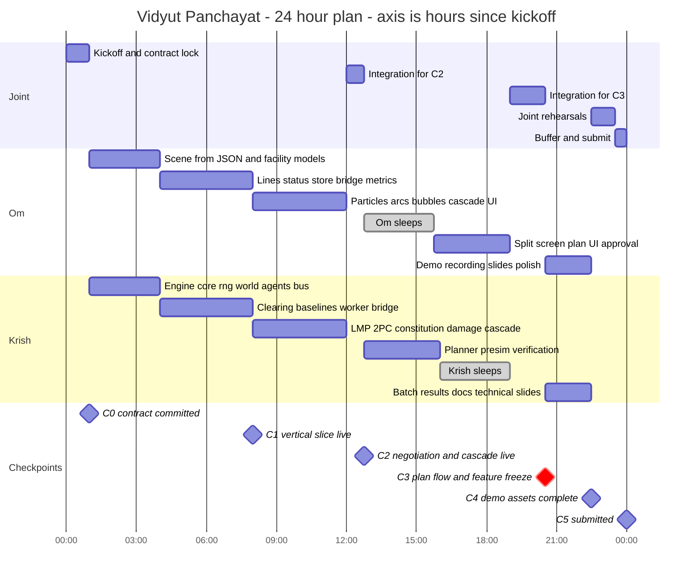
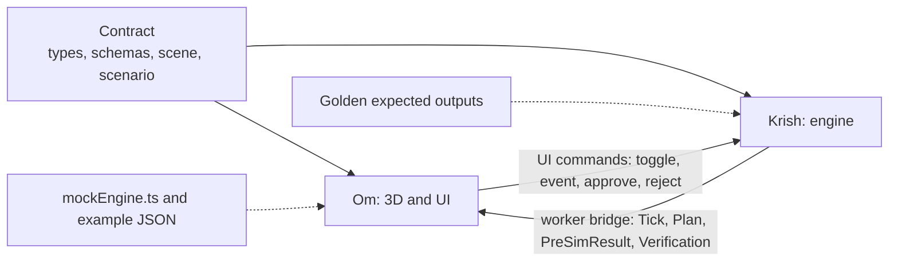
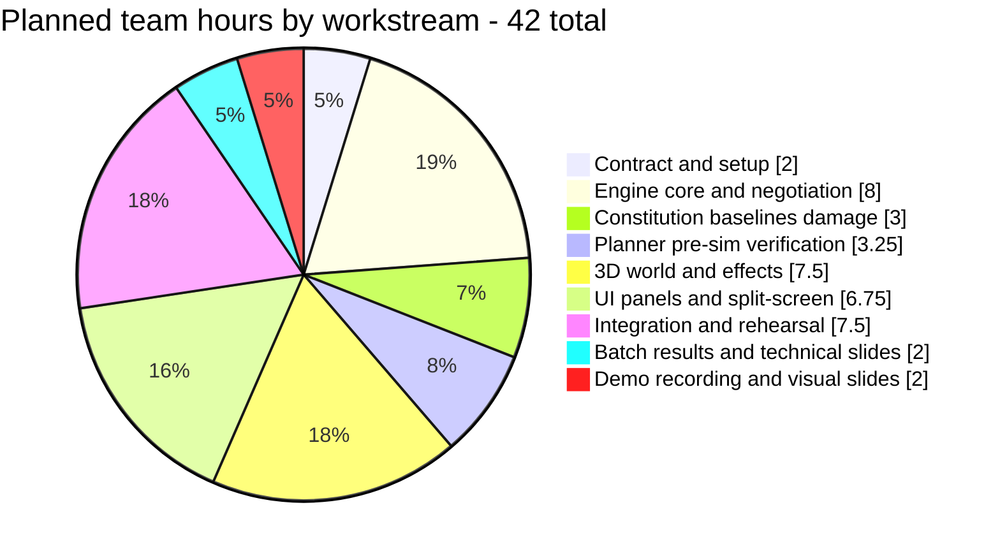
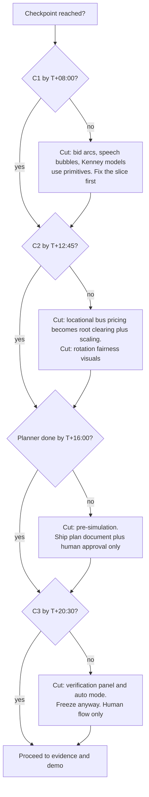

# Vidyut Panchayat: 24-Hour Execution Timeline
### How a two-person team builds PS 1.1 in one hackathon day

| | |
|---|---|
| **Event** | Build Beyond'26, Gradient Club, AIML Dept, BMS College of Engineering |
| **Project** | Vidyut Panchayat (विद्युत् पंचायत), PS 1.1 |
| **Team type** | **Two-participant team** |
| **Om Rashiya** | rashiyaom@gmail.com, **Frontend, 3D and Demo Lead** |
| **Krish Ardeshana** | krishardeshana@gmail.com, **Simulation Engine Lead** |
| **Companion file** | `architecture.md` (what we build and why) |
| **Status** | Finalized Round 1 execution plan. Every checkpoint is pending until the build begins; section 16 records actual progress. |

> **Reading the clock.** `T+00:00` is kickoff and `T+24:00` is the deadline. Times are hours since kickoff, not wall-clock times. Replace them with real times once the schedule is announced.
>
> **Assumed role split.** Om takes the frontend, 3D world and demo, based on his stated strength. Krish takes the simulation engine, protocol and metrics. If either of you is stronger at the other side, swap the columns. The schedule still works, because the only requirement is that each person owns one half end to end.

---

## Table of contents

1. [Team and ownership](#1-team-and-ownership)
2. [Operating rules](#2-operating-rules)
3. [The 24 hours at a glance](#3-the-24-hours-at-a-glance)
4. [Who is awake when](#4-who-is-awake-when)
5. [Phases and exit criteria](#5-phases-and-exit-criteria)
6. [Hour-by-hour plan](#6-hour-by-hour-plan)
7. [Checkpoints and acceptance tests](#7-checkpoints-and-acceptance-tests)
8. [Dependencies, handoffs and mocks](#8-dependencies-handoffs-and-mocks)
9. [Effort allocation](#9-effort-allocation)
10. [Git workflow](#10-git-workflow)
11. [Communication and decisions](#11-communication-and-decisions)
12. [Cut list and decision rules](#12-cut-list-and-decision-rules)
13. [Timeline risks](#13-timeline-risks)
14. [Final-four-hours runbook](#14-final-four-hours-runbook)
15. [Demo day roles and deliverables](#15-demo-day-roles-and-deliverables)
16. [Actuals log (fill in during the event)](#16-actuals-log-fill-in-during-the-event)

---

## 1. Team and ownership

| | **Om Rashiya** | **Krish Ardeshana** |
|---|---|---|
| Role | Frontend, 3D and Demo Lead | Simulation Engine Lead |
| Email | Rashiyaom@gmail.com | krishardeshana@gmail.com |
| **Owns** | `src/world3d/`, `src/ui/`, `src/app/`, `src/compare/`, `public/models/`, `demo/`, `presentation/` (visual slides) | `src/engine/`, `src/worker/`, `tests/`, `scripts/batch.ts`, `experiments/`, `docs/` (protocol, damage, impact), `presentation/` (technical slides) |
| Builds | The 3D city, power lines, particles, effects, playback, split-screen, plan and approval UI, pre-sim and verification panels, presenter mode, demo recording | Agents, negotiation protocol, price clearing, two-phase commit, Constitution, damage and cascade model, baselines, planner, pre-simulation, verification, batch experiments |
| Presents | Story, live demo, interface | Protocol, Constitution, results, Q&A on technical depth |
| Machine | MacBook, 8 GB RAM, 120 GB SSD. **This is the presenting laptop.** | Own laptop |

**Shared:** the contract (`src/contract/`, `data/`), scenario tuning, integration, slides, rehearsal.

**Contract ownership:** Krish owns engine-side types (`Tick`, `Plan`, `PreSimResult`). Om owns UI-facing shapes (scene layout, display fields). Any change to `src/contract/` or `data/` needs the other person's review (see section 10).

---

## 2. Operating rules

1. **Contract first.** Types, zod schemas, scene, scenario and agent profiles are written and committed in the first hour. Nothing else starts before this.
2. **Vertical slice by T+08:00.** Ugly is fine: boxes that change color from live engine ticks. Everything after is improvement, not construction.
3. **Work against mocks, not against each other.** Om builds against `mockEngine.ts` and golden JSON, and Krish builds against fixtures in `tests/`. Neither waits for the other.
4. **The frontend renders and never decides.** The engine decides and never draws.
5. **Feature freeze at T+20:30.** After that: bug fixes, recording, slides, rehearsal only. No exceptions.
6. **Cut by the list, not by panic.** The cut list (section 12) has triggers decided in advance.
7. **Staggered sleep.** One person is always working. Nobody sleeps before T+12:45. Do not skip sleep entirely.
8. **Commit small, push hourly.** Any laptop can die.
9. **Never run batch jobs while recording or presenting.** The presenting laptop has 8 GB RAM.
10. **Protect the Must tier** (`architecture.md` section 23). Everything else is negotiable.

---

## 3. The 24 hours at a glance

The axis shows hours since kickoff (`00:00` is T+00:00).



---

## 4. Who is awake when

One character per hour. `█` means working, `░` means asleep or unavailable. The date on the Gantt axis is a placeholder.

```
Hour        000000000011111111112222
            012345678901234567890123
Om          █████████████░░░████████     asleep about 12:45 to 15:45
Krish       ████████████████░░░█████     asleep about 16:00 to 19:00
Both awake  █████████████░░░░░░█████     joint work possible only here
```

**Why this shape.**
- The two integration points (C2 at 12:00 and C3 at 19:00) fall in the windows where both are awake.
- Each sleeper's counterpart works on something that does not need the other's finished output (mocks bridge the gap).
- Krish sleeps *after* delivering the planner, and Om sleeps *after* delivering the live effects. Each hands off a short written note (section 8).
- Sleep is optional but strongly recommended. If you both skip it, use those hours as buffer, not as extra scope.

---

## 5. Phases and exit criteria

| Phase | Window | Goal | Exit criterion |
|---|---|---|---|
| **P0 Contract** | T+00:00 to T+01:00 | Lock everything both sides depend on | `C0`: types, schemas, scene, scenario, profiles committed, `npm run typecheck` green on both laptops |
| **P1 Foundations** | T+01:00 to T+04:00 | City renders from JSON. Engine core exists | City visible with facility models. Engine produces a basic tick |
| **P2 Vertical slice** | T+04:00 to T+08:00 | Live engine to worker to 3D, with baselines | `C1`: boxes recolor from live ticks, supply drops at hour 2, static baseline runs the same scenario |
| **P3 Depth** | T+08:00 to T+12:45 | Real negotiation, constraints, cascade, effects | `C2`: bus congestion, triage, two-phase commit, Constitution counters, cascade and negotiation effects all visible |
| **P4 Plan layer** | T+12:45 to T+19:00 | Planner, pre-sim, verification, split-screen, approval UI | Components finished on both sides, ready to integrate |
| **P5 Integration** | T+19:00 to T+20:30 | End-to-end human and auto flows | `C3`: full flow works, **feature freeze** |
| **P6 Evidence and demo** | T+20:30 to T+22:30 | Batch results, recording, slides | `C4`: results table, fallback video, slides drafted |
| **P7 Rehearsal and submit** | T+22:30 to T+24:00 | Practice, backups, submission | `C5`: submitted, backups verified |

---

## 6. Hour-by-hour plan

### P0 and P1: contract and foundations

| Window | Om (frontend, 3D) | Krish (engine) | Output |
|---|---|---|---|
| **T+00:00 to 01:00** (joint) | Converts the ASCII layout into `data/scenes/city_v1.json` (8 x 8 grid, facilities, buses, edges). Sanity-checks `npm run dev` | Writes `src/contract/types.ts` and zod schemas. Drafts `data/agents/profiles.json` and `data/scenarios/cyclone_24h.json` | **C0**: contract committed. Each reviews the other's files |
| **T+01:00 to 02:00** | Three.js boilerplate: renderer (pixel ratio cap 1.5), camera, lights, ground plane, road grid from `scene.json` | `rng.ts` (seeded PRNG), `world.ts`, `clock.ts`, scenario `events.ts` producing supply and bus capacity per tick | Empty city renders. Environment ticks deterministically |
| **T+02:00 to 03:00** | Load Kenney `.glb` models, place facilities, text labels. Primitive stand-ins for any missing landmark | Agent class with private state and **bid generation** (d, m, v, φ). Reserve model. `messages.ts` and `bus.ts` (drop, delay, crash injection) | Facilities visible. Agents can emit bids |
| **T+03:00 to 04:00** | Seeded filler buildings (`InstancedMesh`), parks, glow markers, first camera presets | `dependencyGraph.ts`, service-level calculation, damage v0 (no cascade), `recorder.ts` | City looks like a city. Tick records are produced |

### P2: vertical slice

| Window | Om | Krish | Output |
|---|---|---|---|
| **T+04:00 to 05:00** | `store.ts` (mode, history, selection), worker bridge **client** (against `mockEngine.ts`), status colors on facilities | **Price clearing:** concession curves, bisection, triage ladder. Unit tests for monotonicity and feasibility | Facilities recolor from mock ticks. Clearing passes tests |
| **T+05:00 to 06:00** | Power-line meshes (thickness by allocation). **Metrics HUD** | Static priority and equal split baselines. Run the scenario in Node and print metrics | HUD shows numbers. Baselines run |
| **T+06:00 to 07:00** | Playback controls (play, pause, speed), event log | `engine.worker.ts` with typed bridge and **lockstep `STEP`** | Controls work. Worker streams ticks |
| **T+07:00 to 08:00** | Swap mock for the real worker. Fix integration issues | Greedy **optimum** baseline. Fix issues on the engine side | **C1**: live slice works |

### P3: depth

| Window | Om | Krish | Output |
|---|---|---|---|
| **T+08:00 to 09:00** | Power particles along lines, speed by utilization | **Bus capacities with locational prices** (LMP style). Tests for congested buses | Hot bus lines appear |
| **T+09:00 to 10:00** | Bid arcs and speech bubbles from `negotiation.messages` | **Two-phase commit** with hash consensus. Message-drop handling, abort and retry | Negotiation visible. Aborts testable |
| **T+10:00 to 11:00** | Cascade ripple, flicker and blackout effects. Timeline scrubber with event markers | **Constitution validator**, violation and blocked counters, safe fallback | HUD shows Violations and Blocked |
| **T+11:00 to 12:00** | Agent toggles, event buttons, camera presets | **Lagged cascade damage**, tiered fairness, agent-crash and feeder-failure events, determinism test | Toggles fork the timeline. Crash event works |
| **T+12:00 to 12:45** (joint) | Integration session with Krish | Integration session with Om | **C2**: negotiation, congestion, cascade, Constitution counters all live. Tag `c2-negotiation` |

### P4: plan layer (staggered sleep)

| Window | Om | Krish | Output |
|---|---|---|---|
| **T+12:45 to 13:45** | 😴 asleep | **Planner:** forecast supply, 3-hour horizon, plan blocks via forward negotiation | Plan object generated |
| **T+13:45 to 14:45** | 😴 asleep | **Plan document generator** (markdown model). **Plan validator** (I8, pessimistic forecast, contingency branches) | Readable plan, legality checked |
| **T+14:45 to 15:45** | 😴 asleep | **Pre-simulation:** 30 seeded futures, p10 to p90 distributions, baselines. **Verification** classifier (PASS, DRIFT, FAIL) | `PreSimResult` and `Verification` produced |
| **T+15:45 to 16:00** (handoff) | Wakes. Reads Krish's handoff note and tests the new worker messages | Writes the handoff note, merges to `main`, `typecheck` and tests green. Goes to sleep at 16:00 | Clean handoff |
| **T+16:00 to 17:00** | **Split-screen:** two workers in lockstep, one renderer with scissor viewports, labels, shared clock | 😴 asleep | Same disaster side by side |
| **T+17:00 to 18:00** | **Plan document panel**, **approval bar**, Auto and Human mode switch, state-machine UI | 😴 asleep | Human flow UI complete against real plan data |
| **T+18:00 to 19:00** | **Pre-sim fan chart** (canvas), **verification panel**, presenter mode, keyboard shortcuts | 😴 asleep | All panels in place |

### P5: integration

| Window | Om | Krish | Output |
|---|---|---|---|
| **T+19:00 to 20:30** (joint) | End-to-end test of human flow (plan, pre-sim, approve, execute, verify) and auto flow. Fix UI bugs | Same sessions. Fix engine bugs. Tune scenario so the story is clear | **C3 and feature freeze** at 20:30. Tag `v1.0-freeze` |

### P6: evidence and demo

| Window | Om | Krish | Output |
|---|---|---|---|
| **T+20:30 to 21:30** | **Record `fallback_demo.mp4`** (1080p). Build the offline bundle and **test with Wi-Fi off** | **Run the batch** (600 runs) and produce the results CSV and summary table. Pause all other heavy work during recording | Fallback video, offline build, results |
| **T+21:30 to 22:30** | Visual slides: story, screenshots, architecture diagram | Technical slides: protocol, Constitution, results, limitations. `docs/qa_cheatsheet.md` | **C4**: slides drafted, evidence in hand |

### P7: rehearsal and submission

| Window | Both | Output |
|---|---|---|
| **T+22:30 to 23:30** | Two full timed run-throughs of the 3-minute demo, including a failure drill (what if the live demo breaks, so switch to fallback). 15 minutes of Q&A drill from `qa_cheatsheet.md` | Demo is smooth. Roles and handoff lines are practiced |
| **T+23:30 to 24:00** | Submit as the organizers require. Verify the repo link, video, slides. Push and back up the offline bundle to a second place (USB drive or cloud) | **C5**: submitted |

> **If you have a gap.** The most valuable use of any spare minutes is another rehearsal. Do not add features after the freeze.

---

## 7. Checkpoints and acceptance tests

| ID | Time | Test (all must pass) |
|---|---|---|
| **C0** | T+01:00 | `types.ts` and zod schemas exist. `city_v1.json`, `cyclone_24h.json`, `profiles.json` validate against the schemas. `npm run typecheck` and `npm test` are green on **both** laptops. A hand-written example replay of about 10 ticks exists |
| **C1** | T+08:00 | The real engine worker streams ticks. Facilities recolor live. Supply drops at hour 2 and the HUD shows it. Static baseline runs the same scenario. **Violations: 0** displays |
| **C2** | T+12:45 | Bus congestion raises a local price and shows a hot line. Triage fires at the 9 h feeder failure. A dropped-bid test shows abort and safe fallback. Cascade ripples with delay. Agent toggles fork the timeline. Determinism test passes |
| **C3** | T+20:30 | **Human mode:** plan, pre-sim fan chart, Approve, live execution, verification result. **Auto mode** works and a failing guardrail escalates to the human. Split-screen runs smoothly on Om's MacBook. Tag `v1.0-freeze` |
| **C4** | T+22:30 | `fallback_demo.mp4` recorded. Offline bundle runs with Wi-Fi off. Results table generated from the batch. Slides drafted |
| **C5** | T+24:00 | Submission sent. Repo, video and slides links verified. Backup of the offline bundle exists in a second location |

If a checkpoint is missed, use the cut list (section 12). Do not push the schedule.

---

## 8. Dependencies, handoffs and mocks



**Who waits for whom**

| Om needs | From Krish | Until then Om uses |
|---|---|---|
| Live ticks | `engine.worker.ts` at T+07:00 | `mockEngine.ts` (canned ticks) |
| Negotiation messages | Protocol at T+09:00 | Mock messages in the example JSON |
| Plan, pre-sim, verification objects | Planner and pre-sim by T+15:45 | Hand-made `Plan`, `PreSimResult` examples (built in T+12:00 to 12:45 joint block) |

| Krish needs | From Om | Until then Krish uses |
|---|---|---|
| Final scene geometry | `city_v1.json` at C0 | The committed file. Layout changes go through review |
| Feedback on the story | Demo script | Own reading of the scenario table |

**Handoff note** (Krish at T+15:45, Om before sleeping at T+12:45). A short `HANDOFF.md` message in chat or the repo containing: what is done and merged, what is half-done and where, known bugs, the next three tasks in order, and how to run the tests.

**Mock rule.** `mockEngine.ts` implements the exact same bridge interface as the worker. Swapping from mock to real must be a one-line change.

---

## 9. Effort allocation

Planned working time per person: about **21 hours each** (24 hours minus 3 hours of sleep). These are estimates, not measurements.



| Workstream | Om (h) | Krish (h) | Total |
|---|---|---|---|
| Contract and setup | 1.0 | 1.0 | 2.0 |
| Engine core and negotiation | 0 | 8.0 | 8.0 |
| Constitution, baselines, damage | 0 | 3.0 | 3.0 |
| Planner, pre-sim, verification | 0 | 3.25 | 3.25 |
| 3D world and effects | 7.5 | 0 | 7.5 |
| UI panels and split-screen | 6.75 | 0 | 6.75 |
| Integration and rehearsal (incl. buffer) | 3.75 | 3.75 | 7.5 |
| Batch results and technical slides | 0 | 2.0 | 2.0 |
| Demo recording and visual slides | 2.0 | 0 | 2.0 |
| **Total** | **21.0** | **21.0** | **42.0** |

Visual load balance (each `█` is about 1 hour):

```
Om     ███████████████████████  21.0
Krish  ███████████████████████  21.0
```

---

## 10. Git workflow

- **Remote:** one GitHub repository, both as collaborators. `main` must always pass `npm run typecheck && npm test`.
- **Branches:** `om/<topic>` and `krish/<topic>`, merged to `main` by fast-forward or rebase. Keep branches short-lived (a few hours).
- **Review rule:** changes to `src/contract/` or `data/` need the other person's quick review (target 5 minutes). Everything else merges after the checks pass.
- **Commit prefixes:** `contract:`, `engine:`, `web:`, `fix:`, `docs:`, `chore:`.
- **Sync:** `git pull --rebase` before every push. Push **at least hourly**.
- **Tags at checkpoints:** `c0-contract`, `c1-slice`, `c2-negotiation`, `v1.0-freeze`, `demo-final`.
- **Large files:** keep video and `.glb` size small (compress models). Do not commit `node_modules`. Store `fallback_demo.mp4` outside git if it is large.
- **Disk:** the 120 GB SSD on the presenting MacBook is ample. Screen recordings are the main consumer, so record at 1080p.

---

## 11. Communication and decisions

**Sync points** (five minutes each, standing up):

| Time | Purpose |
|---|---|
| T+04:00 | Foundations on track? Bridge interface agreed |
| T+08:00 | **C1 review** |
| T+12:00 | **C2 integration** and sleep handoff |
| T+15:45 | Handoff, then second sleep begins |
| T+19:00 | **C3 integration** begins |
| T+22:30 | Final status, rehearsal begins |

**Blocker rule.** If you are blocked for more than **20 minutes**, ask the other person. If blocked for more than **45 minutes**, check the cut list.

**Disagreements.** Make a decision in two minutes. The tiebreaker is *"which choice protects the Must tier?"*

**Do not** discuss new features after T+16:00 unless they are bug fixes.

---

## 12. Cut list and decision rules

Cuts are pre-decided. When a trigger fires, execute the cut without further debate.



**Priority order of cuts** (from first to last):

1. Extra scenarios (`substation_failure`, `agent_crash` as separate files)
2. Sound design
3. Plan tweaking
4. Rotation fairness visuals
5. Fuel and Transit agents' extra cascades (agents stay in the data, tuned later)
6. Speech bubbles, then bid arcs
7. Pre-simulation, then verification panel
8. Auto mode (keep human mode)

**Never cut:** negotiation with price clearing, the Constitution and its counters, two-phase commit, the three baselines, the 3D city from JSON, playback, split-screen, agent toggles, the batch results table.

---

## 13. Timeline risks

| Risk | When | Signal | Response |
|---|---|---|---|
| Planner block overruns (3.25 h for three components) | T+12:45 to 16:00 | Planner not done by T+14:00 | Drop verification first, then pre-sim detail (fewer futures) |
| Integration surprises | T+07:00, T+12:00, T+19:00 | Types mismatch, bridge errors | Mocks and zod catch it. Pair-debug together. Do not sleep until C2 is done |
| Split-screen stutters on the 8 GB laptop | T+16:00 | Under 30 fps | Lower the pixel ratio, disable bloom on one viewport, reduce filler density |
| Tuning eats the clock | T+08:00 to 12:00 and T+19:00 to 20:30 | Endless parameter tweaks | Time-box: two tuning blocks only. Freeze `profiles.json` at T+20:30 |
| Sleep skipped, quality drops | After T+16:00 | Careless bugs | Take the sleep window or at least a 45-minute break |
| Wi-Fi or machine failure | Any time | | Offline bundle, hourly pushes, fallback video |
| One person blocked while the other sleeps | T+12:45 to 19:00 | | Handoff note includes next three tasks and mocks to unblock |

---

## 14. Final-four-hours runbook

**T+20:30 (freeze)**
- [ ] Tag `v1.0-freeze`. No new features.
- [ ] `npm run typecheck && npm test` green.
- [ ] `npm run build` succeeds.

**T+20:30 to 21:30 (recording and batch)**
- [ ] Close every other app on Om's MacBook. Only the demo runs.
- [ ] Record `fallback_demo.mp4` at 1080p following `docs/demo_script.md`.
- [ ] Run the offline bundle with **Wi-Fi off**. Confirm it works.
- [ ] Krish runs `npm run batch` (not while recording) and saves the CSV.

**T+21:30 to 22:30 (slides and docs)**
- [ ] Slides: problem, architecture, protocol, Constitution, demo screenshots, results table, limitations.
- [ ] `docs/qa_cheatsheet.md` finished.
- [ ] README: what it is, how to run, team (both names and emails).

**T+22:30 to 23:30 (rehearsal)**
- [ ] Run-through 1 with a timer. Note rough spots.
- [ ] Run-through 2 including a forced failure and a switch to the fallback video.
- [ ] Q&A drill with ten questions.

**T+23:30 to 24:00 (submit)**
- [ ] Confirm the **submission format and deadline** with the organizers (check the brief).
- [ ] Push `main`. Verify the repo opens from a logged-out browser.
- [ ] Upload or link the video and slides.
- [ ] Copy the offline bundle to a USB drive and cloud storage.
- [ ] Charge laptops. Locate chargers and an HDMI or USB-C adapter.

---

## 15. Demo day roles and deliverables

**On stage**

| | Om | Krish |
|---|---|---|
| Opening and story | Leads | |
| Live interface | Drives | |
| Protocol and Constitution | | Explains |
| Results table and limitations | | Explains |
| Q&A | Product, UI and demo questions | Protocol, safety, results questions |
| Backup | Switches to `fallback_demo.mp4` if the live demo fails | Narrates over the video |

**Deliverables**

| Deliverable | Owner |
|---|---|
| GitHub repository (README, source, data) | Both |
| `architecture.md` and `timeline.md` | Both |
| Offline demo bundle | Om |
| `fallback_demo.mp4` | Om |
| Slides (visual part) | Om |
| Slides (technical part) and results table | Krish |
| `docs/` (protocol, damage model, impact model, Q&A cheat sheet) | Krish |

Confirm with the organizers: submission format, presentation length, whether you present on your own laptop, availability of power outlets and display adapters, and Wi-Fi quality.

---

## 16. Actuals log (fill in during the event)

Use this to compare the plan with reality. Add rows as needed.

| Planned | Item | Planned time | Actual time | Status | Notes |
|---|---|---|---|---|---|
| C0 | Contract committed | T+01:00 | | ☐ | |
| C1 | Vertical slice live | T+08:00 | | ☐ | |
| C2 | Negotiation and cascade live | T+12:45 | | ☐ | |
| Handoff | Planner, pre-sim, verification merged | T+15:45 | | ☐ | |
| C3 | Plan flow and freeze | T+20:30 | | ☐ | |
| C4 | Demo assets complete | T+22:30 | | ☐ | |
| C5 | Submitted | T+24:00 | | ☐ | |

**Cuts triggered:** _______________________________________________

**Decisions made:** _______________________________________________

**Lessons for the next hackathon:** _______________________________________________
